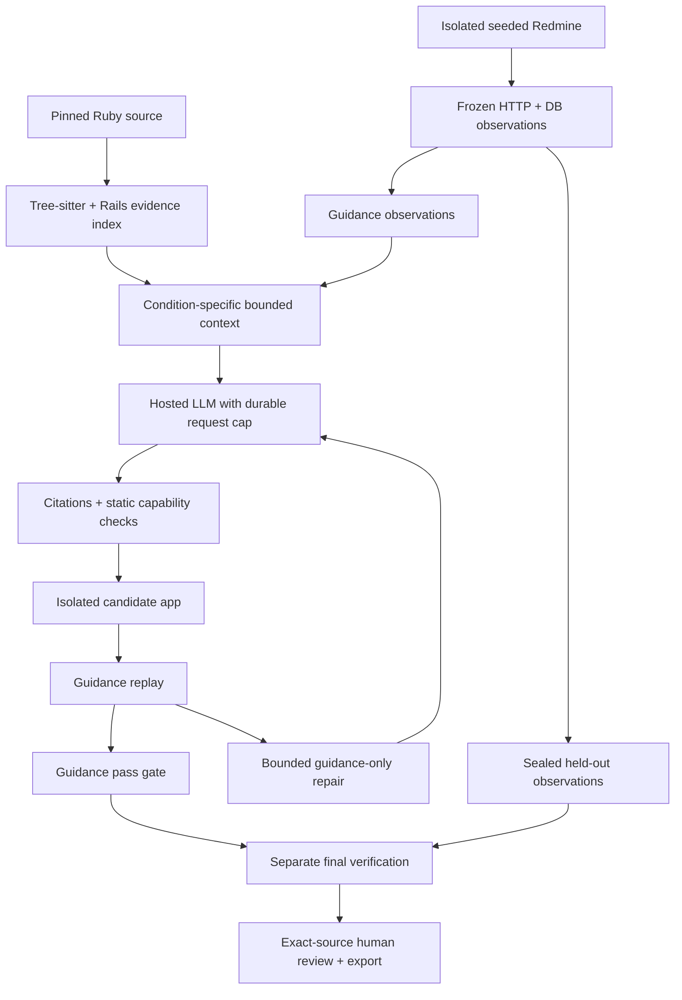

# LegacyLift

**Evidence-driven legacy migration with independent behavioral verification.**

LegacyLift reconstructs selected workflows of a legacy Ruby on Rails application (Redmine) as a modern Python/FastAPI service, then verifies the result against the original instead of trusting the generated code.

  
  
  
  

---

## The problem

Legacy behavior is spread across controllers, models, permissions, persistence, and framework conventions. Translating syntax from one language to another doesn't prove the new code behaves the same.

LegacyLift asks a narrower, measurable question: **given bounded source and runtime evidence, can an LLM generate a replacement REST workflow whose externally observable behavior matches a frozen, independent reference?**

---

## What I built

**1. Evidence pipeline.** I analyze pinned Ruby source with Tree-sitter and Rails conventions, and capture runtime behavior from an isolated, seeded Redmine instance. Observed facts and inferences are kept separate: a convention-based guess is never presented as an observed call trace.

**2. Controlled generation and repair.** A hosted LLM receives a bounded, condition-specific context (source-only, runtime-only, or hybrid) and produces a replacement FastAPI application. Repairs are guidance-only, bounded, and cite supplied evidence.

**3. Independent verification.** The candidate runs in a separate restricted container. I replay the same scenarios against both applications and compare HTTP status, headers, strict JSON, and database and audit state (issues, journals, journal details).

**4. Review workbench.** A React/TypeScript workbench covers evidence, candidate history, mismatches, final verification, and exact-source human review. Export is bound to checksums of the source and the verification report.

**5. Controlled experiment harness.** A pre-registered study design compares evidence conditions under a fixed model, fixed settings, and a hard request budget, with resumable and tamper-evident execution.

---

## Architecture

**Scope.** Redmine 4.2.10 (Ruby 2.7.8, Rails 5.2.8.1) as the reference; Python 3.14, FastAPI, and SQLAlchemy as the target. The slice covers issue creation, visibility-aware retrieval, and status updates, defined by 30 scenarios (3 workflows × 6 guidance + 4 held-out). It is a finite API slice, not a full Redmine rewrite.

---

## Key engineering decisions

**Sealed held-out evaluation.** Held-out expectations never reach the repair loop. A candidate must pass guidance before a separate step opens final verification, and a held-out failure is final. This matters in practice: an early run passed 6/6 guidance but only 2/4 held-out.

**Verify state, not just status codes.** In Redmine, a disallowed New → Closed transition can return `204`, leave the issue unchanged, and still write a journal note. A status-code comparison would miss both effects, so the verifier compares database and audit state.

**Isolation by default.** Legacy and candidate code run in separate containers with no network, a read-only root, dropped capabilities, and resource limits. The host never imports candidate code, expected results stay on the controller, and credentials never enter candidate containers.

**A durable request budget.** A persistent ledger reserves every model call before it is sent. Each lineage gets at most three requests, a new seed can't reset that, and an interrupted call is never silently resent.

**Honest evidence labeling.** Retrieval uses exact source windows with recorded provenance. The system never fabricates missing code and makes no embedding or vector-search claims.

**Failures kept as data.** Provider quota errors, timeouts, and invalid drafts are recorded and never hidden by manual fixes. Guidance replay exposed two protocol bugs of my own: repair prompts dropped the database contract and the original request examples. I fixed both before the controlled study.

---

## Experiment design

- 3 workflows × 3 evidence conditions (source-only, runtime-only, hybrid) × 3 replicates = 27 trials, randomized with a fixed seed, capped at 81 requests.
- Model setup fixed to Groq `gpt-oss-120b`, medium reasoning, temperature 0, with fallback providers disabled to avoid confounding.
- The plan fingerprints its code, inputs, and every saved context before any request.
- Primary outcomes are guidance-pass and full-workflow-pass counts per condition. Secondary outcomes are mismatch categories, repair outcomes, latency, and token usage.

---

## Results so far

| Study | Outcome |
| --- | --- |
| Frozen controlled study (27 trials) | Complete. **No trial passed guidance, held-out, or full-workflow verification.** |
| Exploratory issue-update trial (revised prompt, single request) | **Passed 6/6 guidance and 4/4 held-out** in independent replay. Human review pending. |
| Verifier sensitivity (comparator and reference adapter) | 6/6 deliberately injected faults detected in each |
| Hand-engineered baseline | Matched 4/4 guidance cases (a baseline, not model output) |

**What the results support:** the verification approach works, and a generated candidate can pass both independent gates.
**What they don't support:** a claim that any evidence condition beats another. The positive trial used a revised prompt and settings, so it sits outside the frozen study.

---

## Limits

Results come from one reference repository, three replicates per condition, synthetic fixtures, and a nondeterministic provider. Retrieval judgments are developer-authored. Nothing here generalizes to arbitrary repositories or languages, and matching a legacy response doesn't prove that the legacy policy is desirable.

## Roadmap

- [x] Evidence pipeline, isolated reference capture, and frozen scenarios
- [x] Generation, repair, and independent two-gate verification
- [x] Review workbench with checksum-bound export
- [x] Frozen controlled study (27/27 trials)
- [x] First generated candidate passing both gates (exploratory)
- [ ] Complete human source review and export of that candidate
- [ ] Independent retrieval validation
- [ ] Security advisory triage and clean-checkout reproduction
- [ ] Final case study and demo

---

## Licensing

Redmine is GPL. Exports keep Redmine's GPL notices and identify the derived logic and the migrated slice. I'm not implying permissive relicensing of derived code.

---

## Why I'm building this

I want to build AI systems that solve real engineering problems and are measured honestly, not text generators or API wrappers. LegacyLift sits where AI engineering, backend development, program analysis, and verification meet, and it's a case study in what it takes to trust LLM output.
