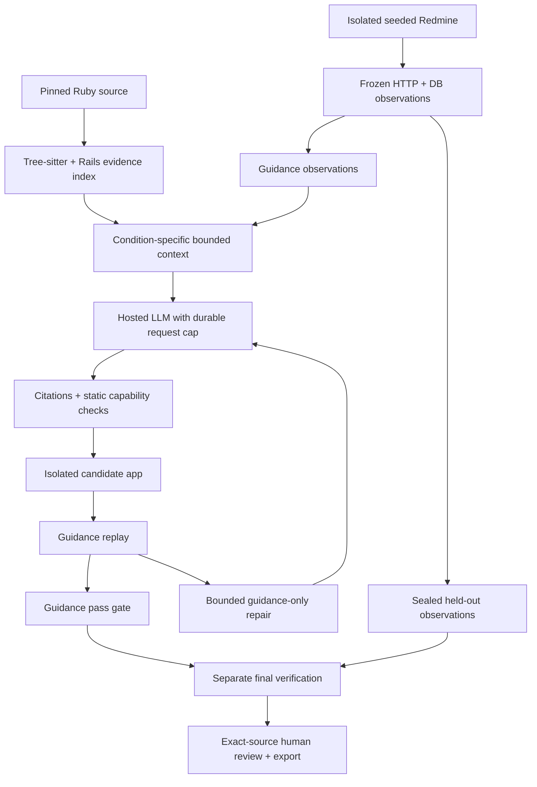

# LegacyLift

**Can an LLM rebuild a legacy workflow so that it behaves exactly like the original? I'm building the harness to measure that.**

<p>
  
  
  
  
</p>

I'm building LegacyLift to test one question: **can bounded source and runtime evidence help an LLM reconstruct a legacy REST workflow whose externally observable behavior matches an independent reference?**

I don't trust "the generated code looks right." Legacy behavior lives in controllers, models, permissions, persistence, and framework conventions, so translating syntax doesn't prove equivalence. LegacyLift replays the same scenarios against the original and the reconstruction, and compares HTTP responses, headers, JSON, and database and audit state.

---

## Where it stands (21 November 2026)

I'm keeping this section blunt, because the results are mixed.

| Result | Outcome |
| --- | --- |
| Frozen controlled study (27 trials, 3 workflows × 3 evidence conditions × 3 replicates) | **Complete. Zero guidance, held-out, or workflow passes.** 62/81 requests used, 309,362 reported tokens |
| Exploratory Redmine issue-update trial (revised prompt, Groq GPT-OSS 120B, one request) | **Passed 6/6 guidance and 4/4 held-out** in independent Docker replay. **Human review still pending** |
| Test suite | 382 passed, 0 skipped, with all Docker smoke gates enabled |
| Comparator and reference-adapter mutation campaigns | 6/6 deliberate faults caught in each |

**What I'm claiming:** the verification pipeline works, and one generated candidate has passed both independent gates.
**What I'm not claiming:** that any evidence condition (source-only, runtime-only, hybrid) beats another. The positive trial used a revised prompt, response format, and reasoning setting, so it sits outside the frozen study and can't support a comparison.

---

## How it works



**Design decisions I care about:**

- **Held-out cases are never used for repair.** A candidate must pass guidance before a separate command opens final verification, and a held-out failure is final. An earlier create run passed 6/6 guidance but only 2/4 held-out, which shows that passing guidance doesn't mean the migration is done.
- **Database and audit state are verified, not just status codes.** In Redmine, a disallowed New → Closed transition can return `204` while leaving the issue unchanged and still writing a journal note. Comparing only the HTTP code would miss both effects.
- **Evidence is labeled honestly.** Source spans come from Ruby Tree-sitter. Rails convention and possible-call inferences are marked as inferences, never presented as observed traces. No embedding or vector-search claims.
- **Strict isolation.** The legacy app and the candidate run in separate restricted containers. The host never imports candidate code, and expected results stay on the controller.
- **A hard request budget.** A persistent SQLite ledger reserves every model call before it is sent. Each lineage gets at most three requests (one initial and two follow-ups), and changing a seed can't reset that. Interrupted calls are never silently resent.
- **Human approval is bound to checksums.** Export unlocks only after a reviewer approves the exact source and verification report.

---

## What it migrates

| | |
| --- | --- |
| **Reference** | Redmine 4.2.10 (pinned commit `9118c6dc…`), Ruby 2.7.8, Rails 5.2.8.1 |
| **Replacement** | Python 3.14 + FastAPI + SQLAlchemy |
| **Scope** | Selected issue creation, visibility-aware retrieval, and status updates, plus supporting writes checked through read-after-write |
| **Contract** | 30 scenarios: 3 workflows × (6 guidance + 4 held-out) |

This is a finite API slice. It is not a full Redmine rewrite, a plugin or UI migration, or a proof of universal equivalence.

---

## Tech stack

| Layer | Tools |
| --- | --- |
| Controller and verifier | Python 3.11, FastAPI, Pydantic, SQLite |
| Evidence | Ruby Tree-sitter, BM25 retrieval, exact source windows |
| Isolation | Docker (non-root, no network, read-only root, dropped capabilities, resource limits) |
| Models | Groq `gpt-oss-120b` (controlled study), Gemini as an optional fallback outside controlled trials |
| Jobs (optional) | PostgreSQL, Valkey, RQ |
| Workbench UI | React, TypeScript, Vite, Monaco, Playwright |
| Quality | pytest, Ruff, `pip check`, mutation campaigns against the verifier |

I build LegacyLift with Codex as my coding assistant. Model-generated candidates are kept strictly separate from hand-engineered baselines, and a baseline is never reported as a model success.

## Repository layout

```text
src/legacylift/
  modernization/     v2 policy: evidence selection, generation, repair, frozen studies, call ledger
  runtimes/          Docker lifecycle and isolated replay for Redmine and the Python target
  workbench/         host API, persistent metadata, local/RQ job dispatch
  legacy_app/ reconstructed_app/ runtime_capture/ static_analysis/
  evidence/ reconstruction/ verification/ evaluation/    v1 prototype, kept as a regression harness
web/                 React/TypeScript workbench with its own lockfile and browser tests
tests/               behavior and integration tests, engineered fixtures
artifacts/           public reports, audits, and screenshots
docs/                architecture, operations, experiments, roadmap, developer guide
```

---

## Evaluation design

- **Plan** `5788dbc4…`: 3 workflows × 3 conditions (source-only, runtime-only, hybrid) × 3 replicates = 27 cells, randomized with a fixed seed, at most 81 requests.
- **Fixed model setup:** Groq `openai/gpt-oss-120b`, medium reasoning, temperature 0. Fallback providers are disabled in controlled trials to avoid confounding.
- **Tamper resistance:** the plan fingerprints 40 code and asset files, the fixed inputs, and every saved context before any request. Changing protocol code requires a new versioned plan.
- **Resumable runner:** it uses an OS lock, stores durable per-trial state, and recomputes reports from real artifacts. Relabeling a saved summary can't manufacture a pass.
- **Primary outcomes:** guidance-pass and full-workflow-pass counts per condition. **Secondary:** strict response, state, and audit mismatches, repair outcome, latency, tokens, and evidence provenance. Provider failures are kept separate from candidate defects.

---

## What I learned from the failures

- Generated drafts showed real SQLAlchemy misuse, wrong database URLs, missing server-filled fields, permission mistakes, and wrong headers. I recorded these as measured failures and didn't patch them by hand.
- Guidance replay exposed two protocol bugs of mine: repair prompts omitted the database contract, and they lost the original request examples. I fixed both before the controlled plan.
- Free-tier providers fail in practice, with quota errors, 503s, and timeouts. The ledger preserves all of them, so a missing output is never counted as a success or as free.

---

## Measured implementation results

| Check | Result |
| --- | --- |
| Full workspace suite | 382 passed, 0 skipped (~124 s) |
| Lint / format / deps | Ruff clean, 165 files formatted, `pip check` clean |
| Fresh source-snapshot reproduction | 277 passed, 76 installed file hashes matched |
| Reference reproduction | All 30 observations matched the original oracle hash |
| Engineered baseline | 4/4 guidance cases matched, 7/7 source mutants caught (hand-engineered baseline, not model output) |
| Container assessment | 16/16 measured isolation controls passed |
| Python dependency audit | 48 version pairs checked, zero findings |
| npm dependency audit | 5 high dev-only entries from one open advisory, none production |
| Image advisory scan | Open triage: 51 advisory IDs on the target image |

The 277-test reproduction predates later prompt and isolation changes, so I don't apply it to newer source bytes.

---

## Limits and open work

**Limits:** results come from one repository, three replicates per condition, provider nondeterminism, and synthetic fixtures. Retrieval judgments are developer-authored (29 development judgments, not an independent benchmark). Nothing here generalizes to arbitrary repositories or languages. Matching a legacy response also doesn't prove its policy is desirable, so any intentional security deviation would need separate sign-off.

**Still open before I call this done:**

- [ ] Complete the human source review and export of the passing issue-update candidate
- [ ] Triage image advisories and resolve or formally accept the dev-dependency finding
- [ ] Add independent retrieval validation
- [ ] Reproduce the final bytes from a clean release checkout
- [ ] Finish the case study, measured resume claims, and demo recording

---

## Licensing

Redmine is GPL. Exports keep Redmine's GPL notices and identify the derived logic and the migrated slice. I'm not implying permissive relicensing of derived code.

---

## v2 commands

All commands run as `python -m legacylift …`. `--home .legacylift` is a v2 option and goes before the subcommand. Setup and optional services are covered in the operations guide.

| Command | What it does |
| --- | --- |
| `v2 prepare` | Import the pinned Redmine source, analyze it, and capture reference observations |
| `v2 seal-study` | Validate and seal the reference artifacts |
| `v2 audit-prompts` / `v2 evaluate-retrieval` | No-model checks of prompt size and retrieval |
| `v2 verify-mutations` / `verify-runtime-mutations` / `verify-candidate-mutations` | Fault-injection campaigns against the comparator, the reference adapter, and an engineered candidate |
| `v2 migrate` | Real provider generation and repair, with scope, provider, and budget options |
| `v2 finalize RUN_ID` | Held-out verification, only after guidance passes |
| `v2 audit-calls RUN_ID` | Inspect a lineage's request accounting |
| `v2 plan-study` / `audit-study` / `run-study` / `study-report` | Plan, check, run, and report the frozen controlled study |
| `v2 serve` / `v2 worker` | Loopback API / host job worker |

I never force changed evidence into an old run or study manifest, and I never resend an uncertain request implicitly.

---

## v1 prototype: Flask to FastAPI tickets

The original prototype is a deterministic Flask/SQLite ticket app reconstructed as a FastAPI service, kept as a separate regression experiment. Its results don't establish Ruby-to-Python migration success.

```powershell
python -m venv .venv
.\.venv\Scripts\Activate.ps1
python -m pip install -r requirements.lock
python -m pip install --no-deps -e .
python -m legacylift demo     # regenerates artifacts, runs differential + held-out checks
python -m pytest
```

Requires Python 3.11+. The lock file and `.python-version` pin the versions behind the committed reports. Optional Groq proposals and reviewed-candidate evaluation are described in [`docs/evaluation.md`](docs/evaluation.md). Use only source you're allowed to share, and never commit your API key.

---

## Docs

- [v2 technical report](docs/v2-technical-report.md) – full implementation and evaluation report
- [Update-candidate review packet](docs/v2-update-candidate-review.md) – the exact source and checksums awaiting approval
- [`docs/architecture.md`](docs/architecture.md) and [`docs/evaluation.md`](docs/evaluation.md) – v1 architecture, metrics, and limits
- [Developer guide](docs/DEVELOPER_GUIDE.md) – file-by-file reference, lifecycle, isolation boundaries, and local artifact map
- [`RESUME.md`](RESUME.md) – exact current state and next steps

---

## Why I'm building this

I want to work on AI systems that solve real engineering problems and are measured honestly, instead of text generation or API wrappers. LegacyLift sits where AI engineering, backend development, program analysis, and automated testing meet, and it's also a case study in what it takes to trust LLM output.
