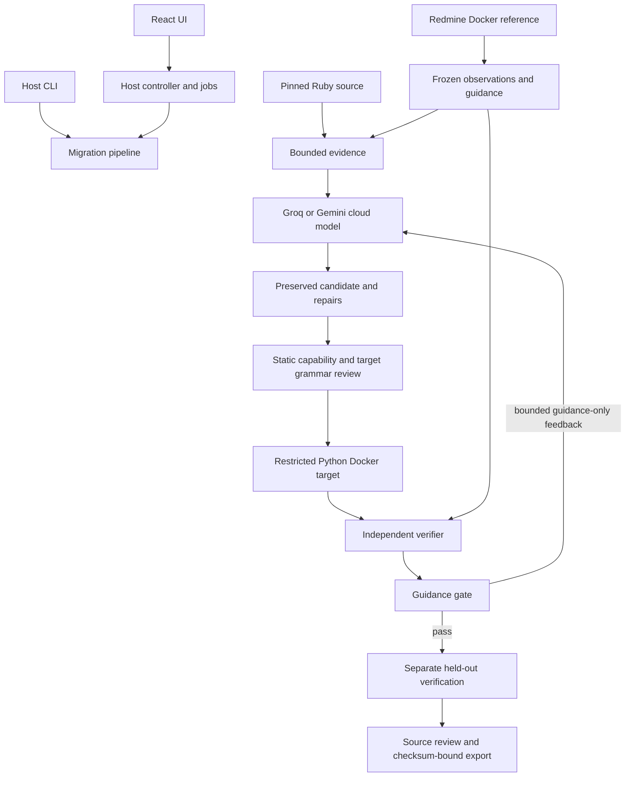

# LegacyLift developer documentation

Latest completed verification for workbench integration: **499 Python tests passed, zero skips**, all four Docker gates, plus three disposable and two genuine saved-run browser tests. Production build/browser type checks, Ruff lint/format (191 files) and dependency consistency passed. No hosted model calls or new candidate approvals. See [RESUME.md](RESUME.md) for exact scope, logs and outstanding read/create gates.

**Workbench integration, 25 November.** `StartJob` now accepts staged-read and Groq reasoning settings; the API validates combinations, restores immutable saved settings, refuses exhausted retries and returns a safe settings projection/live request count. `jobs.py` forwards these parameters to the existing pipeline. `web/src/App.tsx` exposes eligible experimental generation controls, restores saved choices and uses saved retry parameters even when the new-run form is edited; dormant controls are omitted for other workflows. The TypeScript API types cover settings and budgets. `tests/test_workbench_generation.py` verifies API-to-worker dispatch, validation, immutable resume and ledger exhaustion. `web/tests/migration-settings.spec.ts` checks desktop/mobile controls against a disposable no-worker server and exercises retry/exhaustion UI. Existing genuine source/export checks run read-only with a fresh recording prefix. [Current results](RESUME.md).

**Latest short fix, 25 November:** migration termination now preserves actual verification status/source when staged calls exhaust the durable allowance, records `stop_reason=request_budget_exhausted`, and avoids a phantom next attempt. Two regressions cover valid/invalid last repairs and source hashes; related suites passed 202 tests with three opt-in skips. [Exact verification scope](RESUME.md).

**25 November pause checkpoint.** [RESUME.md](RESUME.md) supersedes older active-state notes. Full suite: **481 passed, zero skips**, covering multi-handler repair windows and narrow f-string index-quote recovery. Recovery preserves the parsed model proposal/hashes, changes only proposed replacement text, retains source-window enforcement and still requires normal target checks; it is not semantic certification. The source-snapshot install/reference/browser run passed 470 tests before those final changes. External AI-assisted relevance review is user-accepted; actual annotations and scoring remain pending. The requested blind ZIP is not yet packaged.

Latest 25 November check: **470 tests passed, zero skips**, all Docker gates. V3 stage packets reclaim prompt space for literal Ruby and preserve complete guidance response projections/headers. Medium reasoning is now selected for new staged runs; saved settings are restored on resume. Rejected-output diagnostics record JSON/schema shape and a canonical hash without logging generated values or executing error responses. See [today's record](session-2026-11-25.md) for scope and limitations.

**Active, 25 November 2026.** [Today's record](session-2026-11-25.md) explains staged endpoint calls, partial-response caching, request provenance, safe wrapper normalization and endpoint-scoped evidence. The composed full suite passed 463 tests before those subsequent changes; focused checks passed 170 with three opt-in skips. [RESUME.md](RESUME.md) is authoritative for current status. Older pause/current statements below are dated history.

The [24 November pause handoff](pause-handoff-2026-11-24.md) records the newest architecture. The composed read controller reuses the exact reviewed update source as a hash-checked packaged data asset and delegates PUT to its original handler. The model supplies read/create bodies. The supporting-update guidance replay passed 6/6, focused tests passed 164 with three opt-in skips, and the full composed suite was interrupted at the user's stop request. Its end-to-end read result remains unproven.

Current read generation accepts three body arrays through `read_bodies`, while older `read_handlers` responses retain their parser. `fastapi-read-v3` supplies a string include value, inner issue payloads, SQL helpers and UTC conversion. The repair planner can recover locally from an oversized regeneration and expose assignments responsible for missing mapping values. The [24 November record](session-2026-11-24.md) documents the exact trial outcomes and verification scope.

The [24 November development record](session-2026-11-24.md) documents anchored read evidence, authentication and authorization repair-window changes, the actual bounded trial failures, the 457-test workspace run, and the fresh installation snapshot. Start with [RESUME.md](RESUME.md) for live verification state.

> **Current pause, 23 November 2026.** [The latest session record](session-2026-11-23.md) documents compact exact-line create evidence, bounded repair windows, guidance feedback and the interrupted Groq trial. [RESUME.md](RESUME.md) and [the pause handoff](pause-handoff-2026-11-23.md) record the verified workflow status, test coverage and restart order. Older entries below describe earlier checkpoints.

The current read adapter keeps request parsing and UTC conversion in the controller scaffold. For `fastapi-read-v2`, POST and PUT receive the nested issue map or `None`. The generated handlers decide the response to missing or malformed fields and perform authorization and database changes. `iso_utc` converts untyped SQLite strings and datetimes to UTC/Z and preserves nulls. `parser-window-v1` selects a bounded numbered edit for a localized syntax error in a typed fragment. Listings, evidence echoes and failures without a usable location can still be regenerated. The original v1 scaffold is available for saved artifacts. [Current measurements](RESUME.md).

> **Resumed 23 November 2026.** The read/hybrid scaffold in `modernization/scaffold.py` supplies GET, POST and PUT adapters, token lookup, mapping reads, transaction writes and the fixture clock. `generation.py` binds its version/hash and asks for three synchronous model handlers. The verification pipeline checks the assembled source and retains actionable boot errors for repairs. The workbench now displays guidance success and held-out failure separately. See [the latest results](RESUME.md) and [the reproduction receipts](v2-reproducibility.md).

> **Paused by the user, 23 November 2026.** [The detailed development record](session-2026-11-23.md) documents deterministic ZIPs/manifests, current saved/seeded validation, transactional repair rollback and provenance, genuine update browser/export replay, model reasoning/budget findings, mutation campaign design and every new file's responsibility. Create now matches 6/6 guidance after one repair; its exact-source held-out verification is the first resume action. Update remains approved/exported and freshly replayed at 10/10. The mutation campaign reports 8/9; its corrected step-path version awaits rerun. Start with [RESUME.md](RESUME.md) and [the pause handoff](pause-handoff-2026-11-23.md). Older active/pending-review/provider-key statements below are historical.

> **Larger cloud models and real export, 22 November.** The user-approved update has been exported through the actual checksum gate. [Free-model integration](free-model-providers.md) explains `modernization/openrouter.py`, its catalog/pricing guard, 48 KB profile, broader source/runtime packing, 12K output budget, typed citations, client changes, configuration and tests. [RESUME.md](RESUME.md) records active verification and remaining work. The older pending-review statements are historical.

> **22 November 2026 — active development.** [Today's implementation record](session-2026-11-22.md) explains the synchronous create scaffold, named SQL/mapping helpers, preflight checks, read line-array generation, missing/null repair diagnostics, shorter repair template, exact failed-run evidence and current verification. [RESUME.md](RESUME.md) is the continuation entry point. Historical progress statements below retain their original dates.

> **21 November 2026.** Update/hybrid uses structured source lines for full generation and numbered source windows for repairs. See [RESUME.md](RESUME.md) and the [model-trial log](v2-model-trials.md) for the new protocol and measured outcomes.

> **Latest checkpoint: 20 November 2026.** The update/hybrid 14 KB prompt cap and Docker-enabled full suite passed; the latest model draft was blocked by static review. The frozen study recorded no passing migration. See Sections 29–30, [RESUME.md](RESUME.md) and handoff Section 38. Older ACTIVE/live-session and 25/27 statements are historical.

Development history is recorded through 20 November 2026. Section 28 records the latest implementation verification and negative model-trial outcomes.

This is a developer reference for the original prototype and current Rails migration platform. Directory organization is the current design, not an irrevocably final structure. The records establish milestone chronology, not a literal minute-by-minute edit history. Reasons below explain current responsibilities; no exhaustive historical comparison of all alternative frameworks was recorded.

## 1. Reading order

Read this guide for architecture and file responsibilities, [RESUME.md](RESUME.md) for the current checkpoint and restart order, [v2-roadmap.md](v2-roadmap.md) for acceptance gates, and Section 36 of [the handoff](v2-handoff-2026-11-16.md) for exact latest implementation and verification status. Older handoff sections preserve historical checkpoints. [architecture.md](architecture.md) primarily describes v1. Detailed companion records are [operations](v2-operations.md), [controlled evaluation](v2-controlled-evaluation.md), [retrieval evaluation](v2-retrieval-evaluation.md), [model trials](v2-model-trials.md), [original experiment](model-experiment.md), [evaluation](evaluation.md) and [project brief](project-brief.md).

## 2. Objective and authorship

Reconstruct selected Redmine 4.2.10 Ruby/Rails issue workflows in Python 3.14/FastAPI/SQLAlchemy and independently verify behavior. Scope includes creation, visibility-aware retrieval and status updates with journals. Reading after writes requires supporting POST/PUT operations. This is not a complete Redmine rewrite.

Codex implements LegacyLift's controller, UI, adapters, verifier, engineered fixtures, tests and documentation. Upstream developers authored Redmine. Groq/Gemini produce experimental replacement applications and repair edits. Engineered baselines cannot be labelled model-generated success. The Codex conversation is separate from LegacyLift's provider-key usage.

## 3. Development chronology

1. Bootstrap established the Python src package, dependency configuration/lock, pytest, Ruff, ignore rules and README.
2. The original Flask/SQLite ticket prototype made HTTP/session/database behavior observable. Python AST analysis and deterministic capture produced a typed Engineering Evidence Record (EER).
3. An independently engineered FastAPI baseline and differential tests established the verifier without requiring cloud models.
4. Source-only/runtime-only/hybrid provider experiments preserved raw failures, reviewed execution and separately labelled compatibility repairs. The offline demo summarizes recorded outcomes.
5. The user selected Ruby/Rails to Python/FastAPI and authorized choosing a public legacy repository. Redmine introduced real authorization, Rails conventions, validation and audit behavior.
6. Pinned source/archive/runtime, synthetic fixtures and repeated independent captures established the v2 reference. Historical Docker-unavailable/static/alternative-runtime work remains separate from current Docker results.
7. Runtime adapters, frozen scenarios, generation/repair/finalization, metadata/jobs, optional Postgres/Valkey/RQ and React workbench were implemented.
8. Source templates, measured Rails dispatch, citation allowlists, retrieval diagnostics and role-diverse exact source windows improved evidence. Dependency reranking remained experimental because early create relevance worsened.
9. Host Python 3.11 incorrectly rejected valid target syntax; restricted Python 3.14 AST review corrected that mismatch. Default HTTP error-body findings became compatibility advisories while capability blocks remained.
10. Latest work added persistent request budgets, sealed guidance, exact-buffer checks, public read/write scope correction, immutable study planning and serial crash-safe execution/reporting.
11. Pause checkpoint: 269 tests passed; no generated workflow passed both verification gates. Reproducibility scripting/build-tool selection was only being scoped.

The handoff also records Git ownership fixes, Docker daemon/image lookup failures, Windows fixture cleanup locks, browser checksum corrections and provider quota/timeouts. Missing timestamps are not reconstructed as facts.

## 4. Execution architecture

The UI/controller run on the Windows host. Application code runs in Docker. Model inference runs in the provider cloud; authenticated requests originate on the host. Expected outcomes stay outside candidate images. Most candidate trials compare against saved reference observations rather than rebooting Redmine every time.

## 5. Directory responsibilities and reasons

| Directory | Responsibility and design purpose |
|---|---|
| `src/legacylift/` | Installable package; src layout separates imports from root tooling/tests. |
| `legacy_app/`, `reconstructed_app/` | Original controlled prototype and independent engineered baseline with explicit provenance. |
| `runtime_capture/`, `static_analysis/`, `evidence/` | Original observation, syntax analysis and typed EER stages; inference and observation remain distinct. |
| `reconstruction/`, `verification/`, `evaluation/` | Original provider interface, comparison and experiment/report operations retained for regression. |
| `modernization/` | v2 migration policy, evidence selection, generation, repair, frozen studies, integrity and experiment orchestration. |
| `runtimes/` | Application/language execution boundary, Docker lifecycle and transports, independent of generation policy. |
| `runtimes/assets/` | Trusted fixture/driver/configuration files shipped as package data, distinct from generated source. |
| `workbench/` | Host API, persistent metadata and local/RQ job dispatch. |
| `web/` | Browser application with independent Node lock/build/browser tests. |
| `tests/` | Behavior/integration checks and engineered fixtures, not production migration implementations. |
| `artifacts/` | Selected public reports, diagnostics and screenshots with version/provenance context. |
| `.legacylift/` | Ignored private controller storage: repositories, fixtures, synthetic actor keys, drafts, ledger, plans and metadata. |
| `docs/` | Architecture, operations, experiments, roadmap and checkpoint history. |
| `.github/workflows/` | Historical/optional automation; no current authorization to push or dispatch. |

Retaining v1 beside v2 preserves a functioning regression harness during the transition. Future consolidation remains possible after acceptance gates pass. The layout does not prove every planned adapter or deployment feature exists.

## 6. Root files and dependency choices

`pyproject.toml` defines the package, Python >=3.11 controller requirement, bounded dependencies, console entry, package-data rules, pytest and Ruff. Setuptools is the build backend. `requirements.lock` pins tested controller/development versions but currently omits build-tool pins. `.python-version` selects host 3.11; candidate Python is separately pinned in Docker.

`.gitignore` excludes secrets, environments, databases, caches and local runs. `.env.example` is a template; `.env` is private. The loader accepts supported variables only: do not assume every arbitrary entry becomes configuration. Never copy keys into docs, exports or application images.

`Dockerfile.evaluation` is the v1 evaluator, distinct from v2 trusted image definitions in `runtimes/images.py`. `.dockerignore` controls build context. `compose.yaml` supplies optional loopback Postgres/Valkey with dynamic host ports; the controller/worker stay on the host and applications receive no Docker socket. `README.md` links the original prototype to current v2 work. Unrelated `ion` must be preserved.

| Dependency | Role and reason |
|---|---|
| Flask | Controlled original prototype; real v2 reference is Rails. |
| FastAPI/Pydantic/Uvicorn | Typed controller API, validation and ASGI serving; also target application stack. |
| HTTPX | Provider REST transport. Direct REST avoids requiring local model inference or large provider SDKs. |
| SQLAlchemy/psycopg | Controller persistence, generated target database access and optional PostgreSQL support. |
| RQ/redis client/Valkey | Optional durable queue; Windows uses SimpleWorker because fork is unavailable. |
| Alembic | Planned migration support dependency; no complete Alembic chain should be inferred merely from installation. Current additive store upgrades live in store logic. |
| Tree-sitter/Ruby grammar | Source syntax facts and locations; dynamic Ruby semantics remain uncertain. |
| rank-bm25 | Lexical retrieval and diagnostic baseline. |
| python-multipart | API multipart/form support. |
| pytest/Ruff | Behavior tests and lint/format policy. |
| React/TypeScript/Vite | Browser composition, types and build/dev server. |
| TanStack Query | UI request/cache updates. |
| Monaco | Read-only source inspection; large editor code is loaded asynchronously. |
| Recharts/lucide-react | Results visualization and icons. |
| Playwright | Real browser tests, including disposable synthetic review/export. |

SQLite enables simple default local operation. Optional Postgres/Valkey are controller infrastructure, separate from the synthetic legacy fixture database. No full comparative framework benchmark was recorded.

## 7. Preparation and evidence flow

`workbench/cli.py` dispatches preparation to `modernization/study.py`. The importer validates a pinned archive and extracts it without executing imported application code on the host. Ruby analysis records evidence. The reference adapter boots Rails with trusted fixture assets, captures routes and observations, resets between scenarios and stops its container.

Reference commit: `9118c6dcb4ffe203f7029eb89523cd8a56b85cde`. Archive SHA-256: `20078424a6e07073407c24dd7f4e356837299c48a24651ceb7427967706c69b7`. Runtime image digests live in runtime modules and the handoff. Preserve upstream GPL attribution; derived source is not automatically permissively licensed.

Source-only, runtime-only and hybrid are separate evidence conditions. Shared schema/public API requirements are common inputs. Schema excludes fixture row values. Runtime projections expose selected guidance responses/changed rows; private actor tokens and held-out observations are excluded.

Source windows retain evidence IDs, source hashes, inclusive line locations and omission/truncation metadata. The packer uses complete original lines and diversifies semantic roles. It does not invent missing code. Workflow bindings are task-contract facts; observed Rails routes establish dispatch only. Static name matches remain possible relationships. Current relevance labels are a development diagnostic, not an independent general benchmark.

All 12 user-prompt variants fit 16,000 UTF-8 bytes; provider wrappers/system messages are additional. Repair prompts retain full candidate source while compacting duplicate references/feedback. Local budget rejection sends no request.

## 8. Generation, verification and repair lifecycle

1. `pipeline.migrate` creates or validates a run, freezes context and reuses eligible saved drafts. Changed contexts cannot silently overwrite provenance.
2. `generation.generate` requests structured migration output or exact line-anchored edits. Evidence citations must belong to the supplied allowlist. Edits must match source and cannot overlap.
3. Each HTTP POST reserves a durable ledger slot first. A root and seeded descendants share three attempts, including fallback/failure/uncertain requests. Missing keys, local rejection and zero-call replay are separate. This is not an account-wide billing limiter.
4. Static review blocks prohibited capabilities. A pass permits restricted execution, not a security claim.
5. Guidance replay compares independent outputs/state. Feedback preserves already-passing guidance IDs; at most two repairs are configured, subject to the actual HTTP cap.
6. Infrastructure failure does not justify blindly spending another model call. Interrupted intents are not presumed unsent.
7. Finalization requires guidance success and matching source. It saves a held-out report/hash and summary. A held-out-evaluated run cannot become a repair seed, including when a stale summary omits that fact.

The frozen contract has 30 scenarios: six guidance/four held-out per workflow. Comparisons include status, strict JSON types/keys/values/order, selected content-type/cache-control/location headers, body emptiness and issues/journals/journal_details. Reset between scenarios; preserve state between steps within a scenario.

The trusted clock controls fixture wall timestamps while monotonic deadlines remain real. A disallowed Rails transition can return 204, retain the old status and still save a note/version change; response-code-only comparison would miss this.

The immutable study seal validates reference/guidance equality and exact input buffers. Guidance replay opens the separate guidance file, not the combined oracle. Held-out verification separately checks the combined reference. Local checksums detect inconsistent edits but are not externally signed protection against an administrator rewriting a workspace.

## 9. Isolation and approval boundaries

Application containers use non-root execution, no network/published ports, read-only root, dropped capabilities, no-new-privileges, resource limits and disposable writable storage. Trusted build definitions copy candidate text without executing it during build. Provider keys, host-wide mounts, Docker socket and expected oracle data stay outside candidates. Synthetic Redmine test authentication tokens are distinct from provider credentials.

Policy 2.3 makes default HTTPException bodies compatibility advisories. The verifier decides actual response behavior. Target AST fallback handles Python 3.11/3.14 grammar differences by parsing candidate text as data in a restricted scanner. Source/policy hashes bind proofs; the API reuses matching proofs without Docker access. This fixed false rejection of valid target f-string syntax.

These controls are defense in depth; broader hostile-code/resource-abuse/dependency security assessment remains open. A Docker-socket-mounted deployment proposal was rejected; host orchestration is the implemented safer layout.

Human source review, compatibility and security are separate verdicts. Approval binds exact source and held-out report; export checks both again. API inspection never imports generated modules. The synthetic browser test exercises approval/export plumbing, not actual human review or migration success.

## 10. Persistence, jobs and controlled study

`store.py` persists jobs, progress events and approvals separately from fixture state. `jobs.py` provides local/RQ dispatch, cancellation checkpoints and compare-and-set ownership. Expired/crashed work is recovered as interrupted rather than successful. Queued API mode excludes model-key loading; the host worker loads keys. Default local in-process mode keeps provider access on the controller host.

The controlled design is three workflows × three conditions × three replicates = 27 trials, maximum 81 requests. Manifests bind randomized order, provider/model, code/input/context hashes and runtime provenance. Current valid plan `f41fb6255b9b4f6e891e3047bbdeb58d` fingerprints 38 files and has zero actual controlled requests/outcomes.

The runner defaults to one trial per invocation, holds an OS lock, saves in-progress state and commits outcomes before advancing. A durable result is reused after crash. Provider/runtime failure stops a batch; a later explicit invocation advances past committed failures without resend. Reports recompute rows from artifacts/ledger and reject changed success labels. They show condition/status counts, known tokens and unknown usage. Execution-complete does not mean migration success, security assessment or human approval.

## 11. Local artifact map

| Path | Contents |
|---|---|
| `.legacylift/repositories/<commit>/` | Imported pinned upstream source. |
| `.legacylift/evidence/redmine.json` | Cached source analysis. |
| `.legacylift/evidence/runtime_routes.json` | Checksummed observed Rails dispatch. |
| `.legacylift/study/oracle.json` | Private combined reference observations. |
| `.legacylift/study/guidance.json` | Guidance subset and parent identity. |
| `.legacylift/study/integrity.json` | Immutable study/fixture seal. |
| `.legacylift/study/fixture.sqlite3` | Synthetic application database. |
| `.legacylift/study/actors.private.json` | Private synthetic actor/token mapping. |
| `.legacylift/metadata.sqlite3` | Default controller metadata. |
| `.legacylift/model_calls.sqlite3` | Root bindings and atomic HTTP reservations. |
| `.legacylift/experiments/<id>/` | Immutable manifest, execution state, OS lock file and audited report. |
| `.legacylift/runs/<id>/context.json` | Exact selected evidence context. |
| `draft-N.py`, `draft-N.json` in a run | Source and provenance/static review per attempt. |
| `call-N.json`, provider attempt/failure logs | Intent and safe outcome history; inspect before retry. |
| `guidance-N.json` | Guidance replay/diagnostics. |
| `app.py`, `result.json` in a run | Final saved source and summary. |
| `held-out.json` in a run | Final hidden evaluation, ineligible for repair feedback. |
| `seed.json` in a run | Linked source/context provenance. |
| `artifacts/v2/` | Selected public audits, retrieval/prompt/mutation/reference reports and screenshots. |

Ignored does not mean disposable: preserve ledger, frozen data, plans and runs together. No bulk cleanup; no private storage in public GitHub artifacts or exports.

## 12. Developer commands

Reference only: the goal remains paused. See the operations guide for setup and optional services.

| Command after `python -m legacylift` | Effect |
|---|---|
| `demo` | Original offline prototype/saved experiment pipeline. |
| `v2 prepare` | Import/analyze/capture reference. |
| `v2 seal-study` | Validate and seal existing reference artifacts. |
| `v2 serve` / `v2 worker` | Loopback API / host RQ worker. |
| `v2 audit-prompts` / `v2 evaluate-retrieval` | No-model context/retrieval diagnostics. |
| `v2 verify-mutations` | Comparator sensitivity. |
| `v2 verify-runtime-mutations` | Real reference-adapter fault campaign. |
| `v2 verify-candidate-mutations` | Restricted engineered candidate-source mutation campaign. |
| `v2 migrate` | Actual provider generation/repair; select scope/provider/budget. |
| `v2 finalize RUN_ID` | Separate final verification after guidance success. |
| `v2 audit-calls RUN_ID` | Inspect lineage accounting. |
| `v2 plan-study --provider groq --seed 20261117` | New prospective manifest, no model request. |
| `v2 audit-study STUDY_ID` | Check code/data/budget bindings. |
| `v2 run-study STUDY_ID --max-trials 1` | Actual bounded model-study execution. |
| `v2 study-report STUDY_ID` | Read/audit saved outcomes without generation. |

`--home .legacylift` is a v2 parent option: put it before its subcommand. Never force changed evidence into an old run/manifest. Never resend an uncertain request implicitly.

## 13. Actual results and failures

Latest full suite: **269 passed in 104.94 seconds**, all four Docker gates enabled, existing Starlette/httpx warning. Focused study/planner/ledger: **27 passed in 26.96 seconds**, with simulated migrations. Synthetic browser review/export: **1 passed in 5.2 seconds**, including build/type checks; Monaco size warning remains. Ruff passed; last broad formatting covered 90 files, with later changed files formatted. Earlier pip/diff checks passed; final post-documentation checks/container inventory were not performed before pause.

Comparator and reference-adapter campaigns each detect 6/6 faults. An engineered Python fixture matches 4/4 selected guidance cases and detects 7/7 source mutations. These are harness sensitivity results, not model migration accuracy. Actual guarded Docker replay reproduced a failing draft's 1/6 while refusing oracle/held-out/credential reads.

Historical create `75ee041be40a4784ac7aaeeeab36f928` passed 6/6 guidance then 2/4 held-out; never repair/seed it. Older Groq roots `961f51b36ba64418b1414dfdecd2a6c4` and `9da28f863ecc41b9b7a5138322266cb4` exhausted three requests each.

Latest four exploratory roots consumed seven HTTP attempts with three completions: Groq read `2a0611ffcc034ad68586ca467cc0c7a9` scored 0/6 then 1/6 then quota; Gemini read `2e78c842302f4c38bf694236baf3dbe5` timed out; Groq create `9c2fa730698d48a1bcd84d984efbfded` scored 1/6 then quota; Gemini create `4977c50fd1ed4e32836e19a32b2d71dd` timed out. No request was resent; no new held-out evaluation or real approval/export occurred. Metadata GET success does not prove generation readiness/billing tier.

Guidance/source diagnoses include colon-prefixed permission parsing, missing-header 422 behavior, string/datetime confusion, hardcoded database URL, wrong response/body/header behavior and tree/journal effects. A permission-removal repair regressed an earlier candidate. Preserve failures and provenance after fixes; do not hand-edit and relabel a model draft as raw generated success.

## 14. Remaining gates and extension rules

Eight phases are numbered 0–7. The baseline gate passed; platform/evidence/verifier/UI are substantially implemented. A genuine dual-gate generated migration remains the Phase 4 gate. Actual controlled execution/analysis/security and release/reproduction/demo/report remain open. A rough 60% scope estimate is not a measured release-completion score or effort guarantee.

No reproduction script/environment exists yet. Build-tool pinning is undecided: host probes found setuptools 65.5.0, no wheel, pip 24.0, npm 11.19.0. A current dirty-source snapshot must not be called a published clean Git checkout.

For a new runtime, implement lifecycle/observations and isolated replay tests. For new evidence, audit contexts and use fresh trials. For changed core study code/inputs, create a new plan. For export, require matching source/report approval. For resume claims, identify actual runs and distinguish engineered fixtures, simulations and generated candidates.

Keep RESUME, latest handoff and roadmap updated after significant work and before pausing. No implementation/provider work resumes until requested. No commit/push/workflow dispatch/publication is authorized. The sections below inventory actual source definitions and tests for detailed navigation.

## 15. File-by-file Python reference

Module summaries and top-level definitions below are extracted from current source. They are a navigation index; nested methods are listed with their owning classes.

### `src/legacylift/__init__.py`

LegacyLift project package.

### `src/legacylift/__main__.py`

Enable ``python -m legacylift``.

### `src/legacylift/cli.py`

Command-line entry point for the deterministic end-to-end demo.

- `run_demo`: Rebuild all artifacts in dependency order and return a concise result.
- `_load_project_env`: Load only the supported API keys from a local ignored .env file.
- `run_proposal`: Generate a review-only proposal with Groq-first fallback or a direct provider.
- `main`

### `src/legacylift/evaluation/__init__.py`

Reproducible evaluation plans and reports.

### `src/legacylift/evaluation/compatibility.py`

Reproducible, labeled harness repairs for the three saved study drafts.

This is a fixed experiment recipe, not a general code repair engine. It reads
candidate text only, rejects unexpected inputs, and never imports model code.

- `_replace_once`
- `_repair`
- `prepare_compatibility_repairs`: Validate every input before saving separate, deterministic repaired copies.

### `src/legacylift/evaluation/plan.py`

Explicit scenario partition for the initial LegacyLift evaluation.

- `split_scenarios`: Split known scenarios and reject unclassified or duplicate inputs.

### `src/legacylift/evaluation/proposal_runner.py`

Evaluate one explicitly reviewed candidate inside the evaluation container.

- `_agreement_metric`
- `evaluate_candidate`: Load a reviewed module and compare it only against the held-out scenarios.
- `main`

### `src/legacylift/evaluation/recorded.py`

Read recorded Docker experiments without executing candidates or calling a model.

- `recorded_comparison`: Include results only when saved candidate and current prompt hashes agree.

### `src/legacylift/evaluation/reviewed.py`

Host-side orchestration for reviewed proposals and restricted Docker runs.

- `CandidateExecutionError`: A reviewed candidate failed inside the evaluator, rather than Docker being unavailable.
  - Methods: `__init__`.
- `_sha256`
- `_expected_prompt_sha256`
- `run_candidate_in_container`: Run a candidate with no network, no host secrets, and a read-only root image.
- `run_reviewed_proposals`: Evaluate current-prompt proposals after declaring who reviewed their source.

### `src/legacylift/evaluation/runner.py`

Build guidance-only evidence and measure the manual baseline on held-out cases.

- `_stable_json`
- `_sha256`
- `_source_digest`
- `_condition_audit`
- `_agreement_metric`
- `_runtime_versions`
- `run_evaluation`: Build a reproducible evaluation report without calling an external model.
- `_write_json`
- `write_evaluation_artifacts`: Write guidance-only runtime/EER inputs and the reproducible report.

### `src/legacylift/evaluation/static_review.py`

Check proposal schema, prompt freshness, and Python syntax without execution.

- `_dotted_name`
- `_function_scope`: Walk one function body without attributing nested functions to its scope.
- `_is_session_route`
- `_writes_session_user_id`
- `_is_current_status_reference`
- `_is_requested_status_reference`
- `_is_session_middleware_registration`
- `_registered_session_observer`
- `_static_findings`
- `inspect_proposals`: Inspect proposal metadata and syntax only; never import or execute candidate code.

### `src/legacylift/evidence/__init__.py`

Versioned Engineering Evidence Record schema and builder.

### `src/legacylift/evidence/builder.py`

Combine static findings and runtime traces without erasing uncertainty.

- `_slug`
- `_step_map`
- `build_eer`: Build a versioned EER from analyzer output and a captured trace bundle.

### `src/legacylift/evidence/schema.py`

Strict Pydantic schema for facts, inferences, unknowns, contracts, and provenance.

- `StrictModel`
- `ProvenanceRecord`
- `EvidenceFact`
- `EvidenceInference`
- `EvidenceUnknown`
- `WorkflowContract`
- `ValidationCase`
- `EngineeringEvidenceRecord`
  - Methods: `references_resolve`.

### `src/legacylift/evidence/storage.py`

Read and write validated Engineering Evidence Records.

- `write_eer`
- `load_eer`
- `write_eer_schema`

### `src/legacylift/legacy_app/__init__.py`

Legacy reference application used to establish baseline behavior.

### `src/legacylift/legacy_app/app.py`

Small Flask application defining the initial ticket workflow behavior.

- `create_app`: Create the reference app; pass DATABASE to isolate tests and scenarios.
- `_error`

### `src/legacylift/legacy_app/db.py`

SQLite setup and request-scoped connections for the legacy reference app.

- `connect_database`: Return a SQLite connection that returns rows by column name.
- `initialize_database`: Create the schema and seed fixtures only when the database is empty.
- `reset_database`: Recreate the database from deterministic synthetic ticket fixtures.
- `get_db`: Get or create this Flask application context's database connection.
- `close_db`: Close the request-scoped connection when the application context ends.

### `src/legacylift/modernization/__init__.py`

Cross-language modernization of explicitly selected legacy workflows.

### `src/legacylift/modernization/call_ledger.py`

Durable request reservations shared by CLI/worker processes and seeded descendants.

- `CallBudgetExceeded`
- `CallLedger`
  - Methods: `__init__`, `transaction`, `_read_json`, `_parents`, `_root`, `_legacy_calls`, `register`, `reserve`, `finish`, `summary`, `validate_existing`.

### `src/legacylift/modernization/contracts.py`

Predeclared scenario identities and strict external observation comparison.

- `scenarios`: Six guidance and four held-out scenarios for each workflow, frozen before generation.
- `canonical_hash`
- `contract_manifest`
- `differences`: Do not conflate bool/int, missing/null, errors, or duplicate array entries.
- `comparable`

### `src/legacylift/modernization/controlled_study.py`

Prospective, immutable 27-trial study planning; this module never calls a model.

- `_root_manifest`
- `_binding`
- `create_study_plan`
- `audit_study_plan`

### `src/legacylift/modernization/frozen_study.py`

Seal reference artifacts once; guidance replay never opens the combined oracle.

- `_path`
- `_read`
- `_validate_cases`
- `_validate_seal`
- `seal_study`: Trusted setup reads the oracle once, without disclosing its observations.
- `evaluation_artifact`
- `execution_inputs`: Hash the exact buffers handed to the runtime, including changes after preflight.

### `src/legacylift/modernization/generation.py`

Bounded cloud generation from guidance evidence, never held-out observations.

- `QuotaExceeded`
- `ProviderFailure`: A bounded provider attempt failed; carries safe, key-free provenance.
  - Methods: `__init__`.
- `PromptBudgetExceeded`: The local request is too large and must be narrowed before any provider call.
- `GeneratedMigration`
  - Methods: `source_must_contain_code`.
- `SourceEdit`
- `GeneratedRepair`
- `_runtime_guidance`
- `supplied_evidence_ids`: Return only evidence identifiers actually included in this request context.
- `_inference_priority`
- `build_context`
- `_prompt_value`
- `_parse_migration`
- `apply_source_edits`: Apply exact, line-anchored edits without executing the generated candidate.
- `_compact_repair_feedback`
- `_repair_source_references`: Add compact, 1-based excerpts around candidate lines implicated by guidance feedback.
- `prompt_for`
- `_gemini_response_schema`: Return Gemini REST's supported JSON response schema for one generation mode.
- `generate`

### `src/legacylift/modernization/mutations.py`

Deterministic sensitivity checks for the frozen behavior comparator.

- `_load_guidance`: Load only the guidance artifact; never open the held-out oracle file.
- `_write_report`
- `_case_mismatches`
- `_mutate`
- `run_mutation_campaign`: Mutate six guidance observations and require the comparator to detect each fault.
- `_ObservationFault`: Inject one controlled fault at the trusted runtime adapter boundary.
  - Methods: `__init__`, `reset`, `request`, `snapshot`.
- `run_runtime_mutation_campaign`: Replay the real reference, then inject faults at its observation boundary.
- `_candidate_source_mutations`: Create isolated source faults across the engineered create/update/read fixture.
- `run_candidate_code_mutation_campaign`: Run a controlled Python candidate and source-mutated variants in Docker.

### `src/legacylift/modernization/pipeline.py`

Generate, preserve drafts, verify guidance and repair at most twice.

- `can_resume_prompt_rebuild`: Allow an explicit local rebuild only when a saved draft preceded the rejection.
- `_feedback_for_next_attempt`: Keep guidance mismatches available when static review blocks a repair patch.
- `_prepare_seed_candidate`
- `migrate`
- `finalize`

### `src/legacylift/modernization/protocol.py`

Code fingerprints for prospective controlled trials; no application or provider execution.

- `input_hashes`
- `code_hashes`

### `src/legacylift/modernization/repository.py`

Import a pinned public reference without executing repository code.

- `source_manifest`
- `verify_source_tree`
- `_write_provenance`
- `extract_source`: Validate the whole archive before writing; publish through an atomic rename.
- `import_redmine`

### `src/legacylift/modernization/retrieval_evaluation.py`

Offline development diagnostic of public Ruby source retrieval, with no oracle input.

- `retrieval_metrics`: Unjudged documents count as zero; recall covers only the declared relevance set.
- `evaluate_retrieval`
- `run_retrieval_evaluation`: Read public source/provenance only; never open study or model-run artifacts.
- `audit_prompt_budgets`: Measure actual guidance-only requests without loading keys or sending them.

### `src/legacylift/modernization/ruby.py`

Ruby syntax evidence and explicitly labeled Rails convention inferences.

- `tokens`
- `rank_workflow`: Rank source facts; the plain BM25 strategy is an explicit diagnostic ablation.
- `select_source_excerpts`: Apply the generation source budget, also used by the offline retrieval diagnostic.
- `analyze_ruby`
- `write_ruby_evidence`

### `src/legacylift/modernization/security.py`

Transparent static review; a passed review is not a security certification.

- `_call_name`
- `_literal_clock_path`
- `review_source`
- `review_target_source`: Use target grammar for syntax/stdlib differences; never execute the candidate.
- `approval_review_passes`: Approval APIs reuse a checksum-bound target review instead of needing Docker access.

### `src/legacylift/modernization/source_packing.py`

Deterministic, source-location-preserving evidence packing for bounded requests.

- `prompt_source`: Remove redundant location metadata from outbound JSON, keeping the saved context intact.
- `source_bytes`
- `category`
- `_line_window`: Choose one contiguous run of complete lines; never insert ellipses into source.
- `_candidates`
- `pack_sources`: Diversify workflow/role coverage under an exact serialized source-array byte cap.

### `src/legacylift/modernization/study.py`

Frozen reference oracles and independent target replay, outside application images.

- `write_json`
- `capture`
- `prepare_study`
- `_runtime_route_evidence`
- `evaluate_source`

### `src/legacylift/modernization/study_execution.py`

Serial, restartable execution of a frozen study with no implicit provider retries.

- `_exclusive_runner`: An OS lock is released on process exit; a leftover file never blocks resumption.
- `_run_directory`
- `_result`
- `_artifacts`
- `_load_state`
- `_trial_record`
- `_report`
- `study_report`
- `run_study`

### `src/legacylift/reconstructed_app/__init__.py`

Hand-built FastAPI baseline reconstructed from the selected EER contracts.

### `src/legacylift/reconstructed_app/app.py`

FastAPI baseline with independently implemented ticket behavior.

- `_SessionObservationMiddleware`: Expose before/after workflow session state to local runners only.
  - Methods: `__init__`, `__call__`.
- `_MatchFlaskSessionCookieMiddleware`: Align Starlette's session cookie attributes with the Flask reference app.
  - Methods: `__init__`, `__call__`.
- `_error`
- `_session_state_from_scope`
- `create_app`

### `src/legacylift/reconstructed_app/db.py`

Independent SQLite storage for the hand-built reconstructed service.

- `connect_database`
- `initialize_database`
- `reset_database`
- `get_db`

### `src/legacylift/reconstructed_app/models.py`

Pydantic request and response models for the reconstructed service.

- `SessionStartRequest`
  - Methods: `normalize_user_id`.
- `TicketCreateRequest`
  - Methods: `normalize_subject`, `validate_description`.
- `TicketStatusRequest`
- `SessionStartResponse`
- `TicketResponse`

### `src/legacylift/reconstruction/__init__.py`

Provider-independent, bounded reconstruction proposal interface.

### `src/legacylift/reconstruction/context.py`

Filter EER evidence and source excerpts into a bounded provider request.

- `_has_allowed_provenance`
- `_source_excerpt`
- `_condition_limitations`
- `build_reconstruction_request`: Select one evidence condition and cap source excerpt and contract count.

### `src/legacylift/reconstruction/models.py`

Typed requests and proposals shared by reconstruction providers.

- `ReconstructionRequest`
- `ProposalDerivation`: Changes to a saved model draft, distinct from original model output.
- `ReconstructionProposal`

### `src/legacylift/reconstruction/prompts.py`

Provider-neutral prompt construction for a bounded EER request.

- `build_reconstruction_prompt`

### `src/legacylift/reconstruction/provider.py`

Provider protocol and a deterministic, credential-free test provider.

- `ReconstructionProvider`
  - Methods: `propose`.
- `DeterministicMockProvider`: Offline provider used for tests and reproducible demos without API keys.
  - Methods: `propose`.
- `_ModelProposal`
- `_safe_api_error_hint`: Expose only short structured API error fields, never raw response text.
- `GroqProvider`: Optional Groq chat provider; model output is returned for human review only.
  - Methods: `__init__`, `from_environment`, `propose`.
- `GeminiProvider`: Optional Gemini GenerateContent adapter; model output remains review-only.
  - Methods: `__init__`, `from_environment`, `propose`.
- `ProviderFallback`: Default to Groq first with Gemini as a backup, or select either directly.
  - Methods: `__init__`, `from_environment`, `propose`.

### `src/legacylift/runtime_capture/__init__.py`

Deterministic runtime capture for the legacy reference application.

### `src/legacylift/runtime_capture/models.py`

Versioned data structures used by runtime capture.

- `ScenarioStep`: One request in a deterministic workflow scenario.
- `Scenario`: An ordered set of requests run against a fresh fixture database.

### `src/legacylift/runtime_capture/runner.py`

Run deterministic scenarios and serialize observed HTTP and SQLite evidence.

- `_session_state`
- `snapshot_database`: Capture only the ticket rows relevant to the selected workflows.
- `_database_delta`
- `_cookie_metadata`
- `_capture_step`
- `capture_scenarios`: Run each scenario against a fresh database and return a stable trace bundle.
- `write_trace_bundle`: Capture and write a stable, UTF-8 JSON trace bundle.

### `src/legacylift/runtime_capture/scenarios.py`

Fixed, synthetic scenarios used to observe legacy ticket behavior.

### `src/legacylift/runtimes/__init__.py`

Language-independent execution boundaries for the v2 migration workbench.

### `src/legacylift/runtimes/assets/candidate_proxy.py`

Trusted loopback driver. This file contains no expected results or scenarios.

### `src/legacylift/runtimes/assets/controlled_mutation_candidate.py`

Engineered guidance-slice candidate used only by the source-mutation gate.

- `_connect`
- `_now`
- `_user`
- `_permissions`
- `_json_headers`
- `_serialize_issue`
- `read_issue`
- `create_issue`
- `update_issue`

### `src/legacylift/runtimes/images.py`

Only trusted Dockerfiles; candidate text is copied, never run during builds.

- `build_image`
- `reference_image`

### `src/legacylift/runtimes/models.py`

Typed, language-neutral observations and explicit runtime boundaries.

- `RuntimeRequest`
  - Methods: `local_path_only`.
- `RuntimeResponse`
- `RuntimeAdapter`: Controllers consume observations, not imported application objects.
  - Methods: `start`, `request`, `snapshot`, `stop`.

### `src/legacylift/runtimes/python_target.py`

Independent Python application container with an oracle-free trusted driver.

- `CandidateRejected`: The candidate itself failed to boot; this may be repaired using guidance.
- `target_base`
- `PythonTarget`
  - Methods: `__init__`, `start`, `request`, `reset`, `snapshot`, `describe`, `diagnostics`.

### `src/legacylift/runtimes/redmine.py`

Pinned, disposable Redmine reference; no application code runs on the host.

- `RuntimeUnavailable`: The Docker infrastructure or approved profile could not be prepared.
- `parse_issue_routes`: Extract selected issue-controller rows from Rails' generated route table.
- `RedmineReference`: All storage is container-local tmpfs; stop removes only this owned container.
  - Methods: `__init__`, `_run`, `_exec`, `start`, `_verify_pinned_image`, `request`, `snapshot`, `reset`, `issue_routes`, `fixture_bytes`, `actor_tokens`, `describe`, `stop`, `__enter__`, `__exit__`.

### `src/legacylift/runtimes/reference_gate.py`

Reproduce the real legacy workflows twice without generating target code.

- `_steps`
- `capture_reference`
- `_digest`
- `verify_reference`: A passed gate proves reproducibility of the observed scope, not a migration.

### `src/legacylift/runtimes/static_review.py`

Run the trusted AST policy under the target interpreter without importing candidate code.

- `run_target_static_review`

### `src/legacylift/static_analysis/__init__.py`

Best-effort static inspection of supported Python source patterns.

### `src/legacylift/static_analysis/ast_analyzer.py`

Extract literal route declarations and selected code references without execution.

- `_FunctionVisitor`
  - Methods: `__init__`, `visit_FunctionDef`, `visit_AsyncFunctionDef`, `visit_Call`, `visit_If`, `visit_IfExp`, `visit_Match`, `visit_Try`, `visit_For`, `visit_AsyncFor`, `visit_While`, `visit_Name`, `visit_Attribute`.
- `_relative_path`
- `_literal_route`
- `_source_files`
- `analyze_paths`: Analyze Python files or directories, reporting parse errors as partial findings.

### `src/legacylift/static_analysis/models.py`

Typed result models for the initial AST analysis pass.

- `RouteFinding`
- `FunctionFinding`
- `AnalysisIssue`
- `AnalysisReport`
  - Methods: `to_dict`.

### `src/legacylift/static_analysis/storage.py`

Serialize static analysis findings as stable JSON.

- `write_analysis_report`

### `src/legacylift/verification/__init__.py`

Behavioral verification for reconstructed workflows.

### `src/legacylift/verification/runner.py`

Replay fixed scenarios against both apps and report behavioral differences.

- `snapshot_database`: Read the ticket state relevant to the selected workflows.
- `database_delta`: Describe inserted, changed, and removed tickets without hiding state changes.
- `cookie_metadata`: Keep cookie attributes while excluding signed/session cookie values.
- `_capture_flask_step`
- `_capture_fastapi_step`
- `_same_typed_value`: Keep JSON types significant, including bool versus int and int versus float.
- `compare_observations`: Return explicit field-level mismatches between two captured steps.
- `_make_step_result`
- `_prepare_apps`
- `compare_scenarios`: Replay scenarios against Flask and a supplied FastAPI app factory.
- `write_differential_report`: Run differential verification and write a stable UTF-8 JSON report.
- `sample_mismatch_report`: Create a labeled mismatch example by mutating one captured result in memory.
- `write_sample_mismatch_report`: Write the synthetic mismatch example used in the project documentation.

### `src/legacylift/workbench/__init__.py`

Local migration workbench API and persistent jobs.

### `src/legacylift/workbench/api.py`

Loopback workbench; the API never imports generated application modules.

- `StartJob`
- `ReviewApproval`
- `create_app`

### `src/legacylift/workbench/cli.py`

Local operator commands for the cross-language workbench.

- `_worker_type`: Select RQ's non-forking worker on Windows, where ``os.fork`` is unavailable.
- `main`

### `src/legacylift/workbench/jobs.py`

One local worker or RQ/Valkey dispatch with persistent compare-and-set claims.

- `Cancelled`
- `execute_job`
- `Dispatcher`
  - Methods: `__init__`, `submit`, `close`.

### `src/legacylift/workbench/store.py`

Persistent controller metadata; application fixture databases live elsewhere.

- `utcnow`
- `Base`
- `Job`
- `Event`
- `Approval`
- `job_dict`
- `Store`
  - Methods: `__init__`, `initialize`, `create`, `get`, `list`, `claim`, `checkpoint`, `finish`, `cancel`, `recover_stale`, `approve`, `approval`.

## 16. Trusted runtime asset map

- `candidate_proxy.py`: Candidate transport/reset/snapshot driver; no expected oracle outcomes.
- `controlled_mutation_candidate.py`: Engineered fixture for source mutation tests.
- `fixture_clock.rb`: Trusted fixture wall-clock support.
- `redmine_database.yml`: Reference database configuration.
- `redmine_secrets.yml`: Disposable reference configuration; not provider credentials.
- `redmine_seed.rb`: Synthetic reference project/users/roles/issues setup.
- `redmine_snapshot.rb`: Selected persisted-state snapshots.
- `request_proxy.rb`: Trusted Rails request transport.
- `reset_database.rb`: Restore database between scenarios.
- `target-requirements.lock`: Exact candidate runtime dependencies.

## 17. Frontend map

- `web/src/api.ts`: Typed browser/controller request helpers.
- `web/src/App.tsx`: Workbench composition, workflow navigation and views.
- `web/src/CodeViewer.tsx`: Monaco source inspection.
- `web/src/main.tsx`: React bootstrap.
- `web/src/monaco-languages.d.ts`: Monaco language types.
- `web/src/style.css`: Layout, states and responsive styling.
- `web/src/vite-env.d.ts`: Vite client types.

Configuration and browser-test files:

- `web/index.html`
- `web/package-lock.json`
- `web/package.json`
- `web/playwright.config.ts`
- `web/playwright.review.config.ts`
- `web/tsconfig.e2e.json`
- `web/tsconfig.json`
- `web/tsconfig.tsbuildinfo`
- `web/vite.config.ts`
- `web/tests/e2e_review_server.py`
- `web/tests/review-export-setup.ts`
- `web/tests/review-export-teardown.ts`
- `web/tests/review-export.spec.ts`
- `web/tests/workbench.spec.ts`

package.json defines scripts/dependencies; package-lock.json pins resolved integrity/version metadata. TypeScript configurations divide application/build/test typing. Vite config controls build/dev integration; Playwright configs separate normal smoke and disposable review-fixture flows. Browser fixture helpers must stop their owned API before Windows database cleanup.

## 18. Test-by-test navigation

Names below identify concrete checks, not independent migration-success cases. Parameterization can produce multiple pytest cases from one definition.

### `tests/conftest.py`

- `app`
- `client`
- `stored_tickets`
- `frozen_reference_inputs`

### `tests/test_call_ledger.py`

- `test_legacy_exhausted_chain_cannot_reset_budget_through_zero_call_or_seed_branch`
- `test_concurrent_reservations_across_seed_branches_never_exceed_three`
- `test_bindings_manifests_and_recorded_outcomes_are_immutable_and_key_free`
- `test_auto_fallback_reserves_each_http_request_and_stops_before_transport_when_full`
- `test_controlled_manifest_fixes_provider_model_and_refuses_seed_extensions`
- `test_seed_cycles_fail_closed_before_any_request_reservation`
- `test_child_crash_after_reservation_keeps_the_request_consumed`

### `tests/test_compatibility.py`

- `test_compatibility_recipe_is_reproducible_and_preserves_raw_drafts`
- `test_compatibility_recipe_rejects_changed_input_before_writing_any_output`
- `test_compatibility_recipe_refuses_to_overwrite_raw_directory`

### `tests/test_controlled_study.py`

- `test_plan_is_balanced_reproducible_key_free_and_makes_zero_requests`
- `test_plan_and_ledger_bind_the_entire_manifest_even_after_local_rehash`
- `test_changed_inputs_or_code_cannot_enter_a_controlled_trial`
- `test_study_cannot_be_planned_from_changed_or_unsealed_guidance`

### `tests/test_differential_verification.py`

- `test_default_scenarios_match_responses_sessions_and_database_state`
- `test_mismatch_report_names_the_differing_field`
- `test_comparison_preserves_response_json_types`
- `test_candidate_request_failure_and_missing_observer_are_recorded_without_aborting`
- `test_differential_report_is_byte_for_byte_deterministic`
- `test_checked_in_differential_report_matches_current_comparison`
- `test_sample_mismatch_report_is_labeled_and_reproducible`

### `tests/test_evaluation.py`

- `test_scenario_split_is_complete_and_disjoint`
- `test_scenario_split_rejects_unclassified_cases`
- `test_evaluation_isolates_guidance_evidence_and_reports_baseline_honestly`
- `test_checked_in_evaluation_artifacts_match_current_run`
- `test_evaluation_report_is_stable_across_runs`
- `test_recorded_experiment_rejects_changed_candidates_prompts_or_parent_hashes`

### `tests/test_evidence.py`

- `test_eer_separates_observations_inferences_unknowns_and_contracts`
- `test_eer_round_trip_and_json_schema_validate`
- `test_checked_in_eer_and_schema_match_current_evidence`
- `test_eer_rejects_missing_provenance_and_unknown_fields`

### `tests/test_frozen_study.py`

- `test_sealing_is_idempotent_preserves_inputs_and_rejects_rewritten_expectations`
- `test_guidance_replay_never_opens_combined_oracle`
- `test_changed_guidance_or_fixture_fails_before_candidate_execution`
- `test_unsealed_and_rehashed_invalid_scenario_sets_are_rejected`
- `test_held_out_artifact_is_separately_checked_and_not_returned_as_guidance`
- `test_changed_guidance_between_preflight_and_load_is_rejected`
- `test_changed_execution_input_after_preflight_cannot_reach_runtime`

### `tests/test_legacy_workflows.py`

- `test_create_ticket_requires_session_and_persists_valid_input`
- `test_create_ticket_rejects_invalid_subject_and_description`
- `test_ticket_retrieval_is_limited_to_the_session_owner`
- `test_ticket_retrieval_rejects_missing_session_and_unknown_ticket`
- `test_status_transition_rules_and_database_state`
- `test_status_transition_rejects_unknown_status`
- `test_reset_database_restores_the_synthetic_fixture`

### `tests/test_modernization.py`

- `test_archive_rejects_unsafe_paths_before_writing`
- `test_archive_rejects_case_collisions_and_symlinks`
- `test_pinned_source_manifest_detects_local_file_changes`
- `test_contract_has_fixed_guidance_holdout_counts_and_multistep_cases`
- `test_guidance_mutation_campaign_detects_auth_response_state_and_audit_faults`
- `test_comparator_mutation_campaign_never_opens_the_held_out_oracle`
- `test_runtime_mutation_campaign_requires_matching_real_runtime_baseline`
- `test_runtime_mutation_campaign_aborts_when_reference_baseline_mismatches`
- `test_runtime_mutation_campaign_replays_pinned_redmine_in_docker`
- `test_controlled_candidate_mutations_each_change_exactly_one_source_anchor`
- `test_controlled_candidate_code_mutations_are_detected_in_restricted_docker`
- `test_all_workflow_context_has_evidence_from_each_slice_and_no_holdout`
- `test_generation_prompt_variants_stay_within_request_budget`
- `test_actual_prompt_audit_preserves_evidence_conditions_and_never_opens_holdout`
- `test_runtime_guidance_preserves_issue_envelope_and_nested_serialized_fields`
- `test_runtime_view_distinguishes_empty_body_from_json_null_without_inventing_unknowns`
- `test_repair_prompt_compacts_feedback_but_keeps_the_runtime_error`
- `test_large_repair_keeps_full_source_and_status_feedback_within_budget`
- `test_repair_feedback_deduplicates_identical_observation_paths`
- `test_source_repair_edits_are_anchored_to_a_complete_line`
- `test_source_repair_accepts_unique_nearby_multiline_anchor`
- `test_repair_prompt_includes_numbered_guidance_failure_locations`
- `test_repair_prompt_calls_out_authenticated_route_fallthrough`
- `test_repair_references_created_issue_row_for_missing_defaulted_field`
- `test_supplied_evidence_ids_include_route_facts_and_repair_allowlist`
- `test_pipeline_blocks_a_repair_with_a_nonmatching_source_snippet`
- `test_pipeline_blocks_candidates_that_cite_unsupplied_evidence`
- `test_repair_preserves_passing_authorization_cases_and_rejects_held_out_feedback`
- `test_static_repair_rejection_keeps_the_previous_guidance_feedback`
- `test_repair_response_uses_strict_compact_edit_schema`
- `test_provider_413_is_a_safe_structured_failure`
- `test_groq_request_uses_strict_schema_for_migration_output`
- `test_provider_validation_failure_records_fields_without_model_output`
- `test_gemini_truncated_completion_is_paused_without_parsing_candidate`
- `test_gemini_repair_request_uses_structured_edit_schema`
- `test_provider_can_repair_source_syntax_after_static_review`
- `test_provider_rejects_empty_generated_source`
- `test_provider_parses_json_wrapped_in_markdown_fence`
- `test_provider_400_records_safe_json_failure_category`
- `test_exhausted_request_ledger_stops_pipeline_before_any_http_request`
- `test_provider_failure_is_saved_and_resume_does_not_resend_by_default`
- `test_guidance_failing_run_can_seed_a_new_repair_run`
- `test_finalized_candidate_is_summarized_and_never_accepted_as_a_seed`
- `test_provider_paused_run_can_seed_its_last_completed_guidance_candidate`
- `test_explicit_provider_retry_appends_audit_history`
- `test_interrupted_later_call_never_sends_a_new_initial_call_implicitly`
- `test_oversized_repair_prompt_is_saved_without_provider_call_or_retry`
- `test_saved_draft_resumes_after_local_repair_prompt_rejection`
- `test_python_target_runs_with_synthetic_state_in_restricted_container`
- `test_comparison_does_not_hide_semantic_mismatches`
- `test_database_and_journal_faults_are_detected_even_with_same_http_status`
- `test_ruby_parser_preserves_source_locations_and_marks_convention_inferences`
- `test_api_templates_are_source_facts_and_route_bindings_are_labeled`
- `test_runtime_route_observations_reach_only_runtime_conditions`
- `test_runtime_route_context_rejects_tampered_route_artifact`
- `test_prepared_runtime_context_requires_route_evidence`
- `test_ruby_workflow_retrieval_prioritizes_entrypoints_and_semantic_dependencies`
- `test_generation_context_carries_provenance_and_labeled_static_inferences`
- `test_required_routes_include_setup_steps_from_selected_guidance`
- `test_public_api_scope_covers_all_predeclared_steps_without_reading_oracle`
- `test_generation_prompt_makes_sqlalchemy_and_response_contract_explicit`

### `tests/test_reconstructed_app.py`

- `test_reconstructed_create_matches_legacy_validation_and_persistence`
- `test_reconstructed_invalid_input_uses_legacy_status_and_error_contracts`
- `test_reconstructed_owner_check_and_session_observer`
- `test_reconstructed_status_transitions_persist_and_reject_invalid_jump`
- `test_reconstructed_rejects_malformed_request_json`

### `tests/test_reconstruction_provider.py`

- `test_reconstruction_conditions_filter_evidence_and_bound_source_context`
- `test_mock_provider_is_deterministic_offline_and_never_returns_code`
- `test_reconstruction_prompt_documents_harness_state_and_observer_contract`
- `test_groq_provider_returns_review_only_code_with_strict_json_schema`
- `test_groq_provider_rejects_citations_outside_the_selected_evidence`
- `test_groq_provider_requires_api_key`
- `test_propose_cli_reports_missing_key_without_traceback`
- `test_groq_provider_reports_auth_and_rate_limit_errors_without_echoing_key`
- `test_cli_can_save_a_mocked_local_proposal_without_executing_it`
- `test_cli_uses_default_output_path_for_proposals`
- `test_gemini_provider_returns_review_only_code_with_structured_output`
- `test_gemini_provider_rejects_citations_outside_selected_evidence`
- `test_gemini_provider_requires_api_key`
- `test_provider_fallback_uses_groq_after_gemini_failure`
- `test_provider_fallback_stops_after_primary_success_and_records_only_that_attempt`
- `test_provider_fallback_rejects_missing_keys_and_does_not_echo_errors`
- `test_provider_fallback_loads_both_configured_providers_in_priority_order`
- `test_provider_can_select_groq_without_configuring_gemini_fallback`
- `test_provider_defaults_to_groq_first_with_gemini_backup`
- `test_default_provider_uses_gemini_after_groq_rate_limit_without_live_requests`
- `test_explicit_provider_selection_requires_its_key`
- `test_cli_passes_explicit_provider_selection`
- `test_propose_cli_defaults_to_automatic_fallback`
- `test_local_env_loader_reads_only_provider_keys_and_preserves_process_environment`
- `test_provider_error_fallback_handles_http_status_and_never_logs_keys`
- `test_groq_bad_request_reports_safe_fields_without_echoing_response_text`

### `tests/test_retrieval_evaluation.py`

- `test_graded_metrics_match_hand_calculation_and_count_missing_documents`
- `test_missing_ambiguous_and_non_development_labels_fail_closed`
- `test_diagnostic_never_reads_study_or_runs_and_preserves_cached_evidence`
- `test_report_and_generation_share_source_budget_with_explicit_truncation`
- `test_dependency_ranking_preserves_static_provenance_and_ignores_ambiguous_edges`

### `tests/test_reviewed_proposals.py`

- `test_candidate_evaluator_uses_only_held_out_scenarios`
- `test_candidate_evaluator_rejects_module_without_app_factory`
- `test_container_execution_error_is_not_hidden_by_stderr_warnings`
- `test_container_rejects_missing_or_non_object_reports`
- `test_reviewed_proposals_requires_explicit_review`
- `test_reviewed_proposals_rejects_conflicting_reviewer_declarations`
- `test_reviewed_proposals_reports_missing_inputs_without_running_docker`
- `test_reviewed_proposals_rejects_a_stale_prompt_before_container_launch`
- `test_reviewed_proposals_accepts_current_prompt_hash`
- `test_agent_review_is_recorded_without_claiming_human_inspection`
- `test_candidate_failures_are_results_but_infrastructure_failures_keep_run_incomplete`
- `test_reviewed_candidate_runs_in_restricted_docker_container`

### `tests/test_runtime_adapters.py`

- `test_runtime_requests_cannot_change_host_or_inject_control_characters`
- `test_runtime_response_preserves_types_and_empty_body`
- `test_redmine_preflight_retries_only_transient_missing_image`
- `test_redmine_preflight_does_not_retry_other_docker_errors`
- `test_redmine_preflight_verifies_digest_through_local_tag_when_qualified_lookup_fails`
- `test_redmine_preflight_rejects_local_tag_with_a_different_digest`
- `test_issue_route_parser_keeps_actual_controller_routes_and_each_verb`
- `test_reference_launch_keeps_application_unprivileged_and_without_host_secrets`
- `test_reference_cleanup_is_attempted_when_initialization_fails`
- `test_reference_gate_detects_non_reproducible_replays`

### `tests/test_runtime_capture.py`

- `test_runtime_capture_records_responses_sessions_cookies_and_database_deltas`
- `test_runtime_capture_observes_ownership_and_stateful_transitions`
- `test_trace_bundle_is_byte_for_byte_deterministic`
- `test_checked_in_trace_matches_current_capture`

### `tests/test_source_packing.py`

- `test_packed_identity_window_is_exact_complete_source_lines_with_unicode_and_escaping`
- `test_overlong_line_is_omitted_instead_of_fabricating_a_partial_source_line`
- `test_workflow_round_robin_preserves_each_entrypoint_and_deduplicates_shared_identity`

### `tests/test_static_analysis.py`

- `test_analyzer_finds_literal_routes_and_session_database_references`
- `test_analyzer_reports_syntax_errors_without_losing_other_findings`
- `test_checked_in_analysis_report_matches_current_source`

### `tests/test_static_proposals.py`

- `test_static_inspector_rejects_stale_code_without_executing_it`
- `test_static_inspector_accepts_current_prompt_for_syntax_preflight`
- `test_static_inspector_accepts_guarded_session_and_status_patterns`
- `test_static_inspector_reports_syntax_errors_without_execution`
- `test_static_inspector_flags_database_ownership_middleware_and_cookie_patterns`
- `test_static_cli_returns_success_when_manual_review_is_required`

### `tests/test_study_execution.py`

- `test_fixed_order_bounded_batches_and_completed_resume_never_repeat_requests`
- `test_provider_pause_is_recorded_and_stops_batch_without_resending_it`
- `test_guidance_gate_finalizes_once_and_keeps_held_out_failure_final`
- `test_crash_after_durable_result_resumes_without_another_provider_request`
- `test_changed_recorded_artifacts_or_trial_identity_fail_closed`
- `test_same_study_cannot_have_two_active_runners`
- `test_os_lock_is_released_after_actual_child_process_exit`
- `test_wrong_durable_trial_identity_never_opens_held_out_verification`
- `test_invalid_batch_limits_are_rejected_before_execution`
- `test_report_cli_does_not_load_provider_credentials`
- `test_rehashed_success_label_cannot_override_actual_trial_results`
- `test_inconsistent_held_out_pass_cannot_be_recorded_as_workflow_success`

### `tests/test_target_static_review.py`

- `test_target_scanner_builds_only_trusted_policy_and_receives_utf8_candidate_as_data`
- `test_target_static_timeout_cleans_only_its_owned_container`
- `test_api_approval_reuses_only_current_policy_and_source_bound_target_proof`
- `test_target_ast_accepts_python314_grammar_and_keeps_capability_blocks`

### `tests/test_workbench.py`

- `test_rq_worker_uses_non_forking_implementation_on_windows`
- `test_job_claim_cancel_and_duplicate_delivery_are_persistent`
- `test_restart_recovery_preserves_live_worker_and_marks_only_stale_jobs`
- `test_api_restart_recovers_job_left_running_by_a_crashed_worker`
- `test_api_rejects_cross_origin_mutation_and_requires_reference`
- `test_api_queues_explicit_provider_retry_for_the_existing_run`
- `test_api_resumes_only_a_saved_draft_after_local_prompt_rejection`
- `test_worker_maps_migration_run_id_separately_from_job_id`
- `test_export_requires_review_of_exact_verified_source`
- `test_store_upgrades_existing_approval_table_with_verification_digest`
- `test_static_policy_blocks_declared_dangerous_capabilities`
- `test_static_policy_blocks_dependencies_outside_the_runtime_allowlist`
- `test_static_policy_allows_standard_library_fastapi_and_sqlalchemy`
- `test_static_policy_blocks_empty_candidate_source`
- `test_static_policy_requires_module_level_asgi_app`
- `test_static_policy_reports_http_body_compatibility_for_runtime_verification`
- `test_static_policy_allows_body_bearing_validation_exception`
- `test_static_policy_defers_custom_error_handler_semantics_to_independent_replay`
- `test_static_policy_does_not_suppress_advisory_for_another_app_or_unrun_registration`
- `test_compatibility_advisory_never_downgrades_capability_block`
- `test_static_policy_requires_fixture_clock_for_write_routes`
- `test_static_policy_accepts_write_route_that_declares_fixture_clock`
- `test_static_policy_recognizes_function_local_fixture_clock_path`
- `test_static_policy_does_not_reuse_clock_alias_from_another_function`
- `test_static_policy_does_not_accept_clock_path_in_a_comment`

## 19. Maintenance note

This guide was created as a documentation-only task after the pause. No tests, dependency installs, candidate executions or generation calls were launched for it. The latest reported checks remain historical measured results. Preserve provenance and update this guide when responsibilities change.

## 20. Development after the pause — 18 November 2026

The user resumed implementation. Added `modernization/source_snapshot.py`: `create_source_snapshot` inventories/copies project files excluding private/local paths; `verify_source_snapshot` verifies inventory/path safety and exact file bytes. Case-insensitive environment filenames and Windows separator escapes have dedicated tests. Added `requirements-build.lock` and `scripts/reproduce_install.py` for a fresh credential-excluded `.venv`, exact dependency/build backend installation and wheel/CLI checks. `scripts/reproduce_checks.py` verifies installed assets, reference replay, Docker-enabled Python tests, lint/format and clean frontend/browser checks. Keeping these developer procedures under `scripts/` separates them from application entry points; the snapshot helper remains importable for project tooling.

Actual reproduction revealed a Windows long-source-path extraction failure. `repository.native_source_path` now supplies native extended paths for source import/manifest/analysis, without changing Windows policy. Staging cleanup verifies its intended parent. Deep-path extraction/analysis and failed cleanup are tested. Docker Desktop also required a socket-only directory preservation workaround; see handoff Section 25 for the exact retained backup. Images/volumes/settings were preserved.

Final reproduction snapshot `ee5c3b3152f444f19193f52371226b19` passed 277 Python tests with Docker gates and no skips, 76 installed-file comparisons, lint/format, frontend build/type checks and one synthetic browser review/export test. The reference checksum matched the original 30-case capture. Read [the reproducibility guide](v2-reproducibility.md) and [selected report](../artifacts/v2/source_snapshot_reproduction.json) for scope, commands, earlier failures and same-host limitations. This does not establish generated migration success.

Subsequent provider probes demonstrated Groq structured-output connectivity and Gemini HTTP 503. An explicitly checkpointed retry of the old quota-rejected create repair remained 1/6 and exhausted its lineage budget. Repair prompts had omitted the provided database URL contract; `generation.TARGET_DATABASE_CONTRACT` is now shared by initial and repair prompts, with compaction coverage. These later changes have separate focused verification; consult current RESUME/handoff for in-flight jobs and final results. Earlier pause/test statements in this guide remain historical.

### Final observed 18 November checkpoint

After the source-snapshot reproduction (277 tests), the shared database-interface prompt change passed 278 Docker-enabled workspace tests. Ruff lint/format (95 files), pip and diff checks passed; no owned containers or intentional model/test jobs remained. The fresh create trial closed at 0/6 → 0/6 → 1/6 with three requests and no held-out evaluation. Its source now reads DATABASE_URL correctly but incorrectly requires server-filled request fields. The next implementation task is byte-bounded, already-supplied guidance request/response examples in stateless repair context; this is not yet implemented. No controlled-model study or successful migration is claimed. See RESUME and handoff Section 26 for exact IDs/logs and continued active-goal scope.

## 21. Keeping relevant observations in stateless repairs

The next implementation fixes the context omission described above. Each hosted request is stateless: including previous source and mismatch paths does not carry forward the original request examples. A generated create handler required status_id even though an already supplied successful request omitted it. This diagnosis came from guidance, not held-out outcomes.

`modernization/generation.py` owns `_repair_guidance_examples` because this is prompt selection, not reference capture or replay. The helper accepts the existing context and guidance feedback, reads no file, and intersects failing IDs with predeclared guidance IDs and the runtime observations actually supplied to that trial. It emits at most two compact observations, preferring status failures. Each keeps its entire request method/path/actor/JSON and expected response status, selected compared headers, body emptiness and validation error strings. It omits request credentials, other response headers, full issue response objects and database snapshots. The list has a separate 1,400-byte UTF-8 cap; a large observation is omitted whole. Source-only remains free of these added runtime examples.

`prompt_for` includes the selected observations in REPAIR_CONTEXT_JSON. Its existing adaptive packing may reduce two observations to one or none to preserve the complete previous candidate and fit the overall 16,000-byte prompt limit. The instructions explicitly distinguish omitted request fields from server-filled defaults and treat observations as data. This improves the opportunity for repair; it does not guarantee model correctness.

`tests/test_repair_guidance.py` covers missing-field retention, private-header exclusion, unknown/held-out/passed/unsupplied IDs, source-only isolation, complete Unicode request bodies and selection in an actual packed prompt. A zero-call replay of the saved failed draft produced `artifacts/v2/repair_guidance_prompt_audit.json`: its 15,363-byte prompt retains the basic request without status_id, expected 201, full previous source and shared database contract. No old run was rewritten or given a new request allowance. Consult handoff Section 27 for live verification and subsequent trial results.

## 22. Repair-format recovery, measured security and study execution

The next fresh exploratory create draft failed at runtime because it used a synchronous SQLAlchemy engine with async context managers. Two subsequent edit responses could not be applied safely. Their rejected edits and unchanged candidate were preserved; neither was replayed, and the lineage closed at three requests. This exposed a format failure that exact patch validation correctly rejected.

`generation.repair_requires_replacement` now detects invalid_repair_edit feedback. The next ordinary request asks for a full source response using the existing GeneratedMigration schema instead of requesting another edit list. `pipeline` records source/edits response formats in call and draft records, keeps the original source and guidance feedback, and applies the same citation/static/runtime checks. It grants no additional request. A simulated end-to-end orchestration regression verifies three actual ledger reservations, the rejected patch staying unapplied, two guidance replays, full replacement persistence and no held-out use. Initial and repair instructions also explicitly require synchronous SQLAlchemy transactions. Groq's configured effort is now medium rather than low and is saved in provenance; actual quality is an experiment, not an assumed benefit.

`modernization/security_assessment.py` is an independent developer assessment of the candidate runtime boundary. It uses a fresh minimal synthetic database and a trusted diagnostic app, not any generated or frozen study candidate. Its reusable functions collect Docker/proc/cgroup/negative-probe evidence and evaluate 16 controls. The command wrapper lives in `scripts/assess_runtime_isolation.py` because it is a developer procedure. `tests/test_security_assessment.py` exercises missing/weakened evidence, sentinel cleanup and a real gated Docker measurement. Actual measurement passed 16/16; the report explicitly excludes security certification, destructive exhaustion and container escape testing.

`scripts/audit_python_dependencies.py` queries public release metadata for exact pins without changing environments. Keeping this procedure outside the application avoids adding network advisory lookups to normal migration flows. It records lock hashes, exact queried versions, known findings and incomplete lookups. `tests/test_dependency_audit.py` uses simulated HTTP responses to cover deduplication, rejected nonexact pins, wrong release identity, unavailable metadata and malformed advisories. Actual Python audit checked 48 version pairs without reported advisories. npm found five high development-toolchain entries stemming from one unpatched picomatch advisory; production-only audit reported zero. These are timestamped scope-limited results, not a blanket safe-dependency claim. See [the security assessment](v2-security-assessment.md).

Full workspace verification after replacement/medium/isolation changes: 300 passed, zero skips, all four Docker gates. The subsequent advisory-script tests passed eight separately. Lint/format passed for 101 files. A new prospective study `5788dbc46e2a46ef8848d44985a0e583` freezes 40 code/asset files, sealed inputs, provider/settings and 27 randomized cells before any of its model requests. Its first three-cell batch is executing; no generated dual-gate pass or completed study is claimed. Read current RESUME and handoff Section 28 before continuing; the frozen protocol must not be edited during these measurements.

## 23. Audited analysis exports and deeper image assessment

`scripts/summarize_controlled_study.py` invokes the real locked study auditor, then emits count-versioned report JSON, trial CSV and Markdown tables. It includes all planned workflow/condition denominators, distinguishes pending cells from observed failures, preserves unknown token usage and labels boot/static failures without completed replay as such. It refuses to replace different existing checkpoint contents. It changes no protocol/runtime file and makes no model request. Actual checkpoint 005 exported successfully: five recorded cells, twelve requests, 63,560 reported tokens, two unknown-usage requests, zero guidance/held-out/workflow passes. This is an incomplete study. See its public artifact directory and current handoff for later batches.

Docker Scout 1.27.0 local one-off scans now cover the trusted target base and frozen historical reference. The target reported 51 advisory IDs over 17 packages (14 high); reference 329 IDs over 43 packages (17 critical). Full raw SARIF is kept in ignored security storage with small hash-bound public summaries to avoid bloating the repository. Rule IDs/result rows/package locations are different counts, and aliases may overlap. No image was updated or published during scanning.

A separate restricted target container read installed distribution metadata only. It found 17 visible distributions and pip 26.2.2, with no separately installed setuptools. The exact-version PyPI audit of that inventory reported no advisories, while Scout points to pip's vendored SBOM for setuptools-related matches. These findings illustrate why requirements-only audits miss bundled components. No finding was suppressed. See [security assessment](v2-security-assessment.md) for versioned hardening and remaining triage work. The fixed study still uses its original image/code hashes.

Latest continuation checkpoint supersedes earlier in-flight notes: **eight controlled cells recorded, 21 requests, 117,320 reported tokens, three unknown-usage requests, no guidance or held-out pass**. Checkpoint 008 exported successfully; 005 is preserved. All model/test/scan sessions are terminal, final owned-container inventory was empty, and the goal remains active. No fingerprinted runtime/application code changed after the plan; later code was independent developer scripts. Read RESUME and handoff Section 30 before the next batch or hardening experiment.

## 24. Verified hardening proposal and requested pause, 18 November 2026

The user requested pausing and saving all continuation documents. The goal is paused; do not start new builds, tests, candidates or provider calls until resumed. Handoff Section 32 and RESUME.md contain the authoritative restart point.

`scripts/prepare_target_hardening.py` is an independent developer procedure, deliberately outside the frozen study's runtime/application tree. `build_proposal` validates the expected scanned base ID and exact Debian version before mutation, copies only trusted Dockerfile/cleanup content into a bounded build context, and records source hashes plus before/after package inventories. It updates zlib to the exact vendor security package, removes unused pip and ensurepip installer archives after dependencies, and sets nonroot ownership for runtime execution. `inspect_image` rejects wrong image identity; `inventory` reads package metadata in an owned restricted container and removes only that container. `verify_proposal` temporarily overrides the base-image function within its own process, runs existing isolation and guidance/source-mutation machinery, restores the override even on failure and checks frozen source hashes unchanged. The separate study process is unaffected.

Inputs/results live under `.legacylift/security/proposals/9758815f421d442492d80241f65a3d8b/`; selected public evidence is `artifacts/v2/target_hardening_proposal.json`. This separation preserves large raw scans, private fixture storage and immutable experimental records without adding them to exported application code. No new dependency was added. `tests/test_target_hardening_tool.py` has six passing tests for invalid parameters, exact-image rejection, container-only cleanup and restoration on failure. These are supplemental to the prior full 300-test suite.

Actual proposal checks: **16 isolation controls passed; 4/4 engineered guidance cases matched; 7/7 source mutants detected; identical guidance-capture hash; frozen code unchanged**. It remains unadopted. Same Python 3.14.10; zlib changed from binary revision -1+b1 to -1+deb13u1; pip and its unused bootstrap wheel were removed, leaving 16 runtime distributions. Scout found 39 advisory rules (six high), reduced from 51 (14 high), with no new rules. Live signed APT metadata/exact package pin is recorded, but it is not a Debian snapshot-based reproduction or a security certificate.

Primary-source triage preserves disagreement: OpenSSL rates the six residual entries Low and lists fixes in upstream 3.5.10; Scout labels them HIGH, and the Debian security package is still installed 3.5.7-1~deb13u3. These results remain open for exact-candidate feature review/vendor remediation. `openssl_applicability_review.json` records both labels and the HTTP-only isolated profile's limits. `advisory_attribution_review.json` separately preserves the conflicting CVE-2026-76844 product attribution. No rule was hidden or lowered to produce a passing security label. The working report's four-case baseline row was also corrected: those were guidance cases, not held-out observations.

At pause, the real model study has **12/27 cells recorded, 28 requests, 147,343 reported tokens, six unknown-usage requests and no guidance/held-out/workflow pass**. The last batch is terminal; no owned container or intentional job remains. Checkpoint 012 JSON/CSV/Markdown is exported and prior checkpoints are preserved. Next untouched run is `cdaa096814ab44638fa9867898d4f1c7`; preserve the fixed protocol and review request-size/quota errors before resuming. Real generated success/review/export, completed analysis, independent retrieval/security expansion and final release/demo/report materials remain unfinished. No publication or Git mutation was performed.

## 25. Resumed execution and study analysis — 19 November 2026

The user reactivated development. Docker Desktop was started through its installed CLI and engine 29.9.2 responded. The existing frozen study audit passed with all 40 code/asset fingerprints and sealed inputs intact. Section 33 of the handoff and RESUME.md track active session handles, further batch outcomes and the current next cell.

`scripts/analyze_controlled_study.py` adds descriptive analysis outside the frozen protocol tree. This placement permits analysis development while preserving the experiment's generation/runtime code. It depends only on Python's standard library and the existing auditor/checkpoint exporter. Its CLI accepts study ID, controller home and output directory. It makes no model or application requests.

`export_analysis` calls the real `study_report`, which acquires the study lock and validates protocol, results and ledger. It then rechecks each result's normalized text checksum against the audit before reading attempt summaries. Exports use immutable count-versioned names beside existing study summaries and CSV. A changed result or live runner raises an error before output is written. Reports contain counts and provenance summaries; they omit source, edit snippets and hidden mismatch payloads.

`analyze` groups recorded trials by evidence condition and retains planned denominators. Provider, boot and static failures contribute to observed full-workflow yield. Unrecorded trials remain pending. Missing guidance replay is null. Repair comparisons require a six-case initial replay and at least one later six-case replay. A previous partial score stays labelled last replay even if a later provider/static attempt terminates the trial. This avoids interpreting an unreplayed attempt as 0/6 or treating partial guidance as held-out success.

`describe` summarizes only observed parsed-output latency. Failed requests, pacing, container startup/replay and overall elapsed time are outside this measurement. Token totals retain the auditor's unknown-usage counts. `wilson_interval` reports a nominal 95% binomial interval for the recorded success fraction and handles an empty denominator with null. Repeated trials share a repository, fixtures and provider conditions. The analysis explicitly records that its intervals cannot establish broad generalization or a significant condition difference.

`tests/test_study_analysis.py` covers missing observations/pending denominators, repair regression and unpaired replay, changed artifacts after audit, live-runner rejection and invalid interval counts. Seven new tests passed in 0.96s. The combined analysis, execution and planning regressions then passed **27 tests in 40.06s**, with the existing Starlette warning. Ruff lint/format passed for both new files. The full previous 300-test Docker suite has a separate verification scope.

The first actual export is checkpoint 013: 13/27 recorded, 30 requests, 153,830 reported tokens, seven unknown-usage requests, no guidance/held-out/workflow pass. Trial 13 produced an initial update candidate but its repair response contained an invalid empty old-text field. Recorded failed cells remain final. A fresh separate Gemini update/hybrid trial returned HTTP 503 without a draft, root `ca9d271b56cb4f3bb0b71ac4de1558a7`, one consumed request. It is excluded from the fixed-Groq study. Current progress continues in RESUME.md.

The next terminal checkpoint is 018, with 18/27 outcomes and 45 reservations. The existing safe source snapshotter preserved 251 files under reproduction 26029d1806f340398a560bfe0cecb87a. A separate process imported its src directory, verified all inventory bytes and validated all 40 study fingerprints. Continuing trials now run through that immutable source with the existing environment. This permits new working-tree development while keeping the actual study executable available. It is not a fresh dependency installation or final release reproduction. Source selection is explicit through a process-local PYTHONPATH, and all old-study reports must use the snapshot as well.

`scripts/assess_static_policy.py` measures security review against inert source strings without executing them. The original policy 2.3 blocked four direct prohibited capabilities but missed three alias/reflection forms. The working-tree policy is versioned to 2.4 and adds prohibited-reference detection before aliasing, from-import alias checks and literal getattr checks. It retains direct-call findings and allows ordinary callbacks/reflection. The same eight specimens now have zero misses; seven new regressions also check approval rejects those forms. Raw specimen reports are separate dated artifacts. Computed names and broader Python obfuscation remain limitations of the static policy.

The first targeted run exposed two assertions tied to the old policy version. After updating those expectations, 127 tests passed with four explicit Docker skips. The full Docker-enabled suite is running and must be observed to completion before claiming its result. Handoff Section 33 and RESUME.md name the exact live sessions. The frozen study continues with policy 2.3, and its historical scanner limitations remain part of the study report.

Subsequent full checks passed **343 tests with zero skips in 136.92s**, including all Docker gates. A later health-model metadata regression passed separately. The frozen study now has **24/27 recorded outcomes**, with no workflow pass. Its provider supplied a 1,441-second quota cooldown. Exact deadlines, root IDs and preserved snapshot commands are in RESUME.md and handoff Section 33.

The new generator retains safe HTTP 413/429 facts through `_quota_diagnostics`. It permits numeric quota headers, known provider codes and recognized limit dimensions, while excluding raw echoed messages and identifiers. `configured_groq_model` and `groq_request_parameters` add an opt-in Qwen preview profile. GPT-OSS remains default. Qwen's thinking-mode call failed JSON generation, so its documented instruct settings are now used for exploratory work. Success provenance captures actual settings. Planning records actual model temperature, and the ledger atomically keeps the model fixed per provider across each lineage. Different-provider fallback still shares the same three-request cap. API health metadata reflects the configured model without exposing key values.

Actual Qwen debugging exposed two framework issues. An earlier candidate called async Request.body() synchronously and ignored its parse error. Shared initial/repair instructions now specify awaited Request-body reads with synchronous SQLAlchemy transactions. Twelve current prompts passed their local byte audit. A later attempt exhausted all request slots before another repair prompt was built. Budget checking now precedes prompt construction, and `summary_for_run` lets the rebuild helper reject old exhausted data without rewriting scientific result files. Existing regression coverage was extended for these exact failure paths.

The newest candidate reads the body correctly but invents the permission name update_issues. Valid update guidance returns 403 where Redmine returns 204. Public `lib/redmine.rb` explicitly maps update to edit_issues. Retrieving top-level access-control DSL declarations is therefore the next source-analysis improvement. Their source facts need exact citations and condition-specific inclusion. Historical sealed inputs stay intact while the remaining fixed-study cells run from the preserved version. No manually repaired candidate or held-out-derived hint was used.

## 26. Source access control and prompt projection

`modernization/access_control.py` adds literal top-level DSL evidence alongside method retrieval. Tree-sitter handles recognized AccessControl.map and project_module blocks, receiver shadowing/reassignment and literal permission/controller/action symbols. Dynamic declarations remain unknown. File/declaration hashes and exact text spans make the binding reviewable. `permission_evidence` verifies the public pinned tree, rechecks the file after verification and filters selected HTTP actions. It never replaces the old cached evidence. Actual source produces 62 literal route declarations and six relevant mappings. Object-level authorization remains unresolved by this syntax alone.

`generation.build_context` derives these facts for source_only and hybrid. Runtime_only stays source-free. Initial and repair prompts receive compact citable mappings while saved context retains original source text and metadata. A new runtime delta view retains inserted projected rows and changed projected fields for updates. This preserves null changes and row IDs while avoiding repeated unchanged state. Runtime HTTP bodies remain intact.

The new packet exceeded the byte limit in read/all hybrid during its first real audit. Prompt projection now keeps behavior/source facts and omits redundant controller bookkeeping. It reduces inferred metadata when required to reserve code space. `retrieval_evaluation.audit_prompt_budgets` measures the actual outbound JSON, including sent permission IDs and omitted inferred records. All twelve variants pass. Individual hybrid workflows retain all six guidance cases. These measurements remain separate from independent retrieval relevance and actual generated compatibility.

The full local suite passed **366 tests with zero skips in 146.67s**, all Docker gates. Actual access-control artifacts are `artifacts/v2/access_control_evidence_v2.json` and `artifacts/v2/prompt_budget_report_access_control_v2.json`. That test run predates the bounded repair-window implementation below.

## 27. Bounded source-window repairs — 19 November 2026

### Why this path was added

Qwen update trial `ed983864b1ba4392b000531939f059ab` generated an invalid Python candidate (line 411) in one initial call. Static review stopped it before execution. The full candidate is 15,755 bytes, and its source-inclusive repair packet exceeded the application's 16 KB request-body budget. No repair request was sent. Sending only a file fragment without integrity and range controls would make exact patch application ambiguous and could let a repair target unseen lines. This implementation adds those checks while keeping the canonical whole candidate available for later static and runtime verification.

### Components and data flow

`src/legacylift/modernization/repair_windows.py` owns source-view construction and validation:

- `select_source_windows(source, anchors, byte_budget)` identifies compact source spans around feedback line anchors and nearby function/class definitions. It serializes deterministically, counts UTF-8 bytes, records omitted lines, line bounds, exact copied contents and a canonical hash of the entire source. It returns no view when a useful window cannot fit.
- `visible_source_ranges(source, source_view)` confirms that the view still refers to the exact full-source hash and that every reported line range/text matches the source. It turns those verified spans into character offsets for edit validation. Empty, stale, malformed, out-of-bounds or modified windows raise a validation error.

`src/legacylift/modernization/generation.py` selects and enforces the view:

- Existing full-source prompt construction remains `_prompt_for_source`. `prepare_prompt` first attempts that existing path so small repair prompts retain the previous full-file behavior.
- If the full prompt is over budget, repair references are derived from the current static/runtime feedback. Deterministic views are tried with 10,000, 7,000, 4,000 and 2,000-byte source budgets. The repair response is requested as anchored exact edits, even when the ordinary feedback policy would request a full replacement.
- `apply_source_edits` keeps exact snippet matching and unique-match safeguards. With a source view, a resolved edit span must fit wholly inside one validated visible range; crossing into omitted lines is rejected. Python string offsets preserve Unicode/multiline edits, while source packet byte accounting is UTF-8.

`src/legacylift/modernization/pipeline.py` persists `source-view-<attempt>.json` and binds the view hash into the corresponding call record. The resulting patched source remains a whole file, not a fragment. It continues through whole-file syntax/static review and the independent guidance runner. The same persistent provider lineage budget applies; a local prompt rejection does not consume a provider request, and an exhausted budget is checked before building a prompt.

### Regression coverage and current verification boundary

`tests/test_repair_windows.py` covers deterministic byte-bounded windows, a line-EOF error anchor, exact source/window integrity, Unicode and multiline replacements, invalid ranges, an edit crossing into an unseen line, oversized prompt fallback and preservation of the old full-source path for small candidates. `tests/test_modernization.py::test_pipeline_repairs_only_visible_windows_and_keeps_full_source` exercises the generated repair/pipeline path and verifies the complete file and source-view/call metadata remain present.

At the time of this Section 27 checkpoint, only the end-to-end window regression had passed and the implementation was not yet fully verified. Section 28 supersedes this interim verification boundary with the combined focused and full-suite results.

### Pause checkpoint and open work

At the time of this Section 27 checkpoint, the fixed study stood at 25/27. This count and its two-cell continuation are historical and superseded by Section 28, which records the audited 27/27 completion. All study artifacts still belong to immutable source snapshot `26029d1806f340398a560bfe0cecb87a`; do not rerun or rewrite recorded cells.

At the time of Section 27, Qwen lineage `ed983...` had two unused request slots and a local prompt-size rejection. Section 28 records the later resumed repair call and HTTP 400; investigate that error before using its one remaining slot. A candidate must still pass guidance before held-out evaluation. Human review, independent retrieval assessment, broader security review, final release reproduction and interview/demo artifacts remain open. [RESUME.md](RESUME.md) and handoff Section 38 are authoritative.

## 28. Verified repair-window implementation and final controlled-study outcome — 20 November 2026

### Repair-window verification

`modernization/repair_windows.py` and the generation/pipeline integration described in Section 27 now have combined post-fix regression coverage. The focused test command covered `tests/test_repair_windows.py`, `tests/test_modernization.py`, `tests/test_repair_guidance.py`, and `tests/test_call_ledger.py`: **117 passed, 3 skipped**. The skips were the three opt-in smoke gates and were enabled in the full run.

Docker Desktop was started; Docker Engine 29.9.2 responded. The full suite ran with `LEGACYLIFT_RUNTIME_MUTATION_SMOKE=1`, `LEGACYLIFT_CODE_MUTATION_SMOKE=1`, `LEGACYLIFT_DOCKER_SMOKE=1`, and `LEGACYLIFT_V2_DOCKER_SMOKE=1`: **378 passed, zero skipped in 124.90 seconds**. Ruff lint passed, Ruff format found **159 files already formatted**, and `pip check` found no broken requirements. The pre-existing Starlette/httpx deprecation warning remains. These are current application/harness checks; they do not show that model-generated code passed compatibility.

### Frozen study reconciliation

The frozen study `5788dbc46e2a46ef8848d44985a0e583` has **27/27 trials recorded**, 62 of 81 request reservations, 309,362 reported tokens and 16 requests with unknown usage. Outcome counts are seven compatibility failures, one candidate boot failure, twelve provider failures, three static-review blocks and four provider pauses. There are **zero guidance passes, zero held-out evaluations and zero full-workflow passes**. The experiment is complete as data collection but has no successful generated migration. Its fixed protocol remains bound to preserved source snapshot `26029d1806f340398a560bfe0cecb87a`.

Complete-state exports were written separately from immutable checkpoint files:

- `artifacts/v2/studies/5788dbc46e2a46ef8848d44985a0e583/checkpoint-027-reconciled/` contains the audited report, summary and trial CSV.
- `artifacts/v2/studies/5788dbc46e2a46ef8848d44985a0e583/analysis-027-reconciled/` contains the descriptive JSON and Markdown analysis.

The working-tree `scripts/summarize_controlled_study.py` and `scripts/analyze_controlled_study.py` were corrected for a fully recorded study. Since the immutable `summary-027.md` and `analysis-027.json` names already existed, the scripts' output was directed into separate output directories and renamed under the reconciled checkpoint paths. The frozen snapshot auditor validated the result. `tests/test_study_analysis.py` passed **7 tests** after the script change. The study source, input seal and prior checkpoint files were not rewritten.

### Provider outcomes and next engineering target

Qwen lineage `ed983864b1ba4392b000531939f059ab` passed saved context/source checks and resumed only its local repair rejection. The provider returned HTTP 400 `json_validate_failed`; the ledger now records two requests used out of three, with one request left. The initial generation was not resent. Do not spend the remaining slot until the structured-response failure is understood.

Separate run `4227e72b7a4e434bab86ef857b6faebf` used three Groq GPT-OSS-120B requests. The initial candidate and first repair were blocked by static review; the first repair edit also failed exact-old-text validation. The final replacement passed static review, but independent guidance replay scored **0/6**. The recorded mismatches point to update database version increments (`lock_version`), journal and journal-detail insertion/value/timestamp behavior, and empty HTTP responses/cache headers on forbidden, unauthorized and missing-record paths. This run has no held-out evaluation or human approval.

On resumption, retain the frozen study unchanged. Use the observed guidance mismatches to improve deterministic behavior contracts and tests before another exploratory model trial. A candidate must pass the six-case guidance gate before any sealed held-out call. Continue the separate retrieval, security/dependency, successful generated migration, human review/export, clean-checkout reproduction and interview/demo gates. No keys, commits, pushes, workflow runs or releases were produced by this checkpoint.

## 29. Update effects contract, schema filtering and provider token-limit diagnosis — 20 November 2026

### Why the update prompt changed

Exploratory update/hybrid run `d4ecf292b50049e6980596a387202725` exposed a mismatch between the actual route permission and the model's inferred permission rules. The route binds update to `edit_issues`, but an intermediate candidate additionally required `edit_own_issues` for the issue author and `add_issue_notes` whenever notes were supplied. The synthetic operator role did not have the first permission, so valid updates were denied. The run used three Groq GPT-OSS-120B calls; its sequence included 2/6, then 3/6, then 0/6 guidance. The final attempt also regressed some status and response-header behavior. The run is exploratory, has no held-out result, and is not part of the frozen study.

### Prompt and context implementation

`src/legacylift/modernization/generation.py` now has two update-specific additions:

- `UPDATE_EFFECTS_CONTRACT` is inserted in both initial and repair prompts when `context["workflow"] == "update"`. It directs the model to honor the route's `edit_issues` binding without inventing extra permission names; update `lock_version` once for each authorized 204; set `updated_on` using the trusted clock even if a disallowed status transition is ignored; apply only permitted transitions; add a journal for notes or an applied transition; add status detail only when the transition applies; and set the close timestamp when the issue transitions to a closed status.
- `UPDATE_SCHEMA_TABLES` limits update prompts to `issues`, `issue_statuses`, `workflows`, `journals`, `journal_details`, `users`, `tokens`, `members`, `member_roles` and `roles`. `build_context` applies this allowlist only for the update workflow. Other workflows retain their existing schema selection.

The shared response contract states that 204 has an empty body, no content-type and `cache-control: no-cache`. Unauthorized, forbidden and missing-record responses have empty bodies, JSON content-type and the same no-cache directive. The model is told to return explicit Starlette `Response` objects rather than raise FastAPI `HTTPException`, which can synthesize a JSON response body. These distinctions come from the independent reference/guidance behavior.

`tests/test_modernization.py` adds coverage for update schema selection and prompt scope, contract inclusion in both initial and repair prompts, exclusion of the update-specific contract from create prompts, and the response wording. Existing prompt-byte and actual-prompt tests guard the final serialized request. `tests/test_retrieval_evaluation.py` validates the budget audit path.

### Verification results and scope

- After the schema filter, the targeted selection for update context, effects-contract prompt wiring, prompt-size checks and actual-prompt auditing passed **15 tests**.
- Before the final schema filter, `tests/test_modernization.py` passed **90 tests with 3 opt-in skips**, and `tests/test_retrieval_evaluation.py` passed **5 tests**. A combined prompt/effects regression selection passed **118 tests with 3 skips** after the contract update. These are distinct runs; do not add their counts.
- `.legacylift/verification/prompt_budget_update_schema.json` records a zero-request, guidance-only local audit. All 12 workflow/condition variants fit the 16,000 UTF-8-byte limit; the largest was 15,966 bytes. Update/hybrid was 15,495 bytes and retained all six guidance examples. It included 2,417 serialized source bytes.
- The earlier full suite is **378 passed, zero skipped in 124.90 seconds** with all four Docker gates. It predates the newest effects-contract and schema-filter edits, so a full Docker-enabled rerun remains necessary. No new full-suite result is claimed here.

### Provider rejection and source-packing interaction

Fresh exploratory run `b028997414d24696bb2bf3d08a955bb0` was started after the prompt changes. Groq rejected the update/hybrid request before returning a draft: HTTP 413 `request_too_large`, with **8,356 requested tokens against an 8,000 TPM limit**. The configured automatic fallback then received Gemini HTTP 503. The ledger records two reservations; no candidate was statically reviewed or executed, and no held-out case was read. This run is terminal as provider failure.

Schema filtering did not materially reduce the complete hybrid prompt. Before filtering, the source packer had 1,759 bytes available for source; after the schema became smaller, it used 2,581 bytes to include more source. The prompt remained 15,495 bytes. This is an allocator interaction: source packing consumes residual prompt budget rather than a fixed workflow-specific source cap. Do not solve it by dropping all source evidence. Inspect the allocation strategy, cap/weight the update evidence roles, retain the required issue authorization/transition/audit/assignment facts and six guidance examples, then re-run the no-request prompt audit. A fresh provider trial should wait until measured prompt reduction clears reasonable token headroom.

### Current continuation and safeguards

1. Modify the update/hybrid source allocation only after inspecting the allocator and its role-priority logic. Add tests that lock both prompt-size headroom and required evidence retention.
2. Run targeted generation/retrieval tests and the zero-request prompt audit; subsequently run the complete Docker-enabled suite because the most recent 378-pass result predates these changes.
3. Do not retry `b028997414d24696bb2bf3d08a955bb0` unchanged. Diagnose separate Qwen lineage `ed983864b1ba4392b000531939f059ab`'s structured-response HTTP 400 before using its one remaining request slot.
4. Use only already-authorized free-tier providers and preserve each lineage's persistent three-request cap. Do not expose keys, put them in artifacts, or pass credentials to candidate containers. A model candidate must pass all six guidance cases before any held-out evaluation; keep held-out observations outside repair context.

The frozen study remains `5788dbc46e2a46ef8848d44985a0e583`, complete at 27/27, with 62/81 reservations, 309,362 reported tokens, 16 unknown-usage requests and zero guidance/held-out/full-workflow passes. Its source snapshot `26029d1806f340398a560bfe0cecb87a` and recorded cells remain immutable. No successful generated migration, human approval/export, independent retrieval benchmark or security certification is established by this checkpoint.

## 30. Update/hybrid prompt cap and safe handling of malformed draft — 20 November 2026

This section records the implementation after Section 29's 15,495-byte prompt / HTTP 413 diagnosis. It is a code and decision record, not evidence that the generated migration succeeded.

### Prompt-size control

In `src/legacylift/modernization/generation.py`:

- `UPDATE_HYBRID_PROMPT_BYTE_LIMIT = 14_000` gives update/hybrid a stricter serialized UTF-8-byte cap to leave headroom under the provider's reported token ceiling. It is a conservative proxy, not an exact token count.
- `UPDATE_HYBRID_SOURCE_BYTE_BUDGET = 2_581` caps source evidence independently. Previously, the generic allocator consumed the schema-filter savings and returned the full prompt to 15,495 bytes.
- `prompt_byte_limit(context)` selects the correct limit for both initial and repair prompts, including the final overflow guard. Repairs cannot silently revert to the global 16,000-byte cap.
- Source selection is versioned `diverse-line-windows-1+update-hybrid-14kb-v1`, making this retrieval policy distinguishable in saved run provenance.
- `retrieval_evaluation.audit_prompt_budgets` stores each variant's `prompt_limit_bytes` so audits apply the matching cap.

The compact instructions retain the database URL/schema and SQLAlchemy contract; async request-body behavior; API-key identity, membership and role checks; route-bound authorization; version/timestamp/journal effects; trusted clock; HTTP body/header requirements; evidence provenance and finite route scope. They prohibit PyYAML and candidate shell, network, subprocess or arbitrary file access, and retain GPL attribution. Source-packing tests assert all six roles remain represented: entrypoint, identity, authorization, transition, audit and assignment.

### Verification and result limits

- Latest Docker-enabled full suite: **382 passed, zero skipped, 123.97 seconds**, with all four smoke gates enabled and one existing Starlette/httpx warning. This supersedes the prior 378-pass result.
- Focused source-packing/modernization/retrieval run: **101 passed, 3 skipped** before one added repair assertion; a later focused repair/prompt selection passed **14 tests**. These are separate invocations.
- Ruff lint passed; Ruff format check reported **165 files already formatted**; `pip check` passed.
- Local audit `.legacylift/verification/prompt_budget_update_token_budget.json`: 12 variants passed, zero provider requests and no held-out reads. Update/hybrid measured 13,588/14,000 bytes, six source documents / 1,851 serialized source bytes, and all six guidance examples. Maximum across variants was 15,966/16,000 bytes.

The byte cap reduces request-size risk but cannot guarantee a provider's tokenizer count. A direct successful provider response was still needed to validate headroom.

### Safe handling of run `34b4b664ca43403b8eb85a2169229b4a`

Two network attempts failed with `ConnectError`; the final Groq `openai/gpt-oss-120b` request returned 3,748 prompt tokens and 3,574 completion tokens (7,322 total; about 8.6 seconds; prompt SHA-256 `e800a643de6621db7213d457bbc55a3a1077ddf89f49fdf678222d2e9d2d99b3`). Static review blocked `.legacylift/runs/34b4b664ca43403b8eb85a2169229b4a/draft-0.py` (5,695 bytes) at line 1 as invalid Python. The candidate was not run, so it has no guidance or held-out score, human approval or security certification. All three request slots in this lineage are consumed and the terminal state is `provider_failed`.

Treat this source as untrusted text. Inspect only its contents and static-review metadata; do not execute or manually edit it. Any new repair requires seed eligibility, exact context/source hash checks and a locally measured repair prompt within the 14,000-byte limit, followed by a fresh lineage. Require 6/6 guidance before held-out execution and human review before approval/export. Frozen study `5788dbc46e2a46ef8848d44985a0e583` remains unchanged, complete at 27/27 with zero guidance, held-out or full-workflow passes. See [RESUME.md](RESUME.md) and handoff Section 38 for the continuation order.
