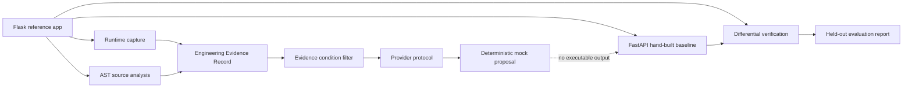

# LegacyLift Architecture

LegacyLift demonstrates a narrow, reproducible modernization workflow using a synthetic Flask/SQLite ticket application. The initial system is intentionally small enough to inspect, and each artifact records what was observed versus inferred.

The mock provider is an offline boundary test. It produces a reviewable proposal summary, never executable code. The FastAPI baseline is hand-built and exists so the comparison and evidence pipeline can be exercised without credentials or network access.

## Components

| Component | Location | Responsibility |
|---|---|---|
| Flask reference | `src/legacylift/legacy_app/` | Defines session, ticket creation, owner retrieval, and status-transition behavior. |
| Scenario capture | `src/legacylift/runtime_capture/` | Replays synthetic workflows against fresh SQLite fixtures and records HTTP, cookie, session, and database evidence. |
| Static analysis | `src/legacylift/static_analysis/` | Reads Python syntax trees and reports supported literal route and code-structure findings without executing source. |
| Evidence record | `src/legacylift/evidence/` | Validates facts, inferences, unknowns, contracts, validation cases, and provenance. |
| Reconstruction boundary | `src/legacylift/reconstruction/` | Filters evidence by source/runtime/hybrid condition, bounds context, and defines a provider protocol. |
| FastAPI baseline | `src/legacylift/reconstructed_app/` | Independently implements the selected workflow for local functional comparison. |
| Verification | `src/legacylift/verification/` | Replays matching scenarios and reports per-field differences in HTTP and persisted state. |
| Evaluation | `src/legacylift/evaluation/` | Builds guidance-only evidence, checks held-out runtime isolation, and measures the manual baseline. |
| Demo CLI | `src/legacylift/cli.py` | Rebuilds all checked-in artifacts in pipeline order. |

## Evidence and trust boundaries

- Runtime scenarios use synthetic identities and fixtures. They do not represent production authentication or real customer data.
- Cookie values are never written into artifacts; only selected cookie attributes are compared.
- The AST pass is best-effort. Dynamic registration, reflection, external services, and unvisited runtime paths are not resolved.
- The EER keeps observed facts, inferences, and unknowns distinct and links claims to source or runtime provenance.
- The evaluation sends guidance traces to runtime/hybrid contexts only. Source-only and hybrid contexts include the complete source tree, which also contains implementations of held-out branches.
- The current comparison measures a manually implemented FastAPI baseline. It does not compare model-generated applications.
