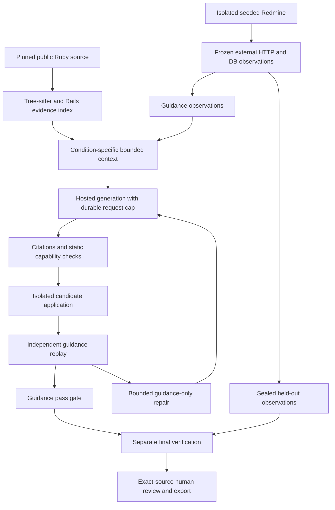

# LegacyLift v2: implementation and evaluation report

> **24 November pause.** Read achieved 6/6 guidance and 2/4 held out on a finalized candidate. The new composed read controller reuses reviewed update code for supporting PUT. That support replay passed six guidance scenarios. Focused checks passed 164 tests with three opt-in skips, and the full composed suite was interrupted by request. The generation trial is quota-paused with no draft. The prior complete full suite passed 461 tests. [Exact checkpoint and limits](pause-handoff-2026-11-24.md).

> **Current pause, 23 November 2026.** The exact-line create evidence audit measured 3/4 selected source rules on Groq and 4/4 on Gemini. The later create trials reached 5/6 guidance without qualifying for held-out replay. Read remains at 3/6 guidance. The latest full workspace suite passed 455 tests before the final feedback change. The approved update is still the only dual-gate result. [Current evidence and restart order](pause-handoff-2026-11-23.md).

> **Resumed measurements, 23 November 2026.** The exploratory Gemini create candidate matched 6/6 guidance after one repair and 1/4 held out. Update remains the approved 10/10 result. Corrected version 2 of the curated generated-update mutation measurement detected 9/9 faults. The [local recorded browser walkthrough](../.legacylift/verification/approved-update-browser-20261123.webm) shows the genuine update results and export. See [the session record](session-2026-11-23.md).

> **Working evidence, 23 November 2026; paused by the user.** The genuine update is approved/exported, passed its real browser results/download flow, and its exact ZIP source again matched 6/6 guidance + 4/4 held-out in Docker. Create run `53ea1530ef2540c7905b8ebc441ada52` matched 6/6 guidance after one repair; no held-out result exists yet. The frozen 27-cell study remains negative and unchanged. A separate curated generated-update mutation campaign reports 8/9; the corrected closure-step metric has not been rerun. [Full record and limits](session-2026-11-23.md). These exploratory results do not establish general migration reliability or security certification.

**Working report, updated 23 November 2026.** A separate exploratory trial generated a Redmine issue update in one Groq request. It matched 6/6 guidance and 4/4 held-out cases in independent Docker replay. The user approved the exact source as goku. Its reproducible archive matched all ten cases again when replayed from the ZIP. Source, verification and approval evidence appear in [the review packet](v2-update-candidate-review.md).

The frozen study is complete at 27/27 trials, with 62/81 requests, 309,362 reported tokens, 16 unknown-usage requests, and zero guidance, held-out, or dual-gate passes. Its [checkpoint 027](../artifacts/v2/studies/5788dbc46e2a46ef8848d44985a0e583/checkpoint-027-reconciled/summary-027.md) and [analysis 027](../artifacts/v2/studies/5788dbc46e2a46ef8848d44985a0e583/analysis-027-reconciled/analysis-027.md) preserve that result. The later positive trial uses a revised prompt, response format and reasoning setting. It cannot establish superiority of any evidence condition. Sections describing earlier trial outcomes are historical.

## Problem and supported migration

Legacy behavior is distributed across controllers, models, framework conventions, permissions, persistence and rendering. Translating method syntax does not establish equivalence. LegacyLift asks whether bounded source/runtime evidence can support generation of a replacement REST workflow whose externally observable behavior matches a frozen independent reference.

The supported reference is Redmine 4.2.10, commit `9118c6dcb4ffe203f7029eb89523cd8a56b85cde`, with measured Ruby 2.7.8 and Rails 5.2.8.1. The replacement is a single Python 3.14/FastAPI/SQLAlchemy application implementing selected issue creation, visibility-aware retrieval and status updates. Supporting write routes are included in read-after-write verification. This is a finite API slice, not a full Redmine rewrite, plugin migration, UI migration or proof of universal equivalence.

The controller runs on Python 3.11. The initial Flask/FastAPI v1 ticket prototype remains a separate regression/experiment; its results do not establish Ruby-to-Python migration success. Codex implements LegacyLift itself; hosted Groq/Gemini requests produce the candidate replacement applications under test.

## System design and rationale

The legacy application and candidate execute in separate restricted containers. The host API never imports candidate modules. Trusted drivers issue loopback HTTP requests and collect selected SQLite state; expected results stay on the controller. Provider clients receive public source excerpts and permitted synthetic guidance, not provider credentials embedded in applications or the private actor-token file.

The source index uses Ruby Tree-sitter spans and explicitly labeled Rails convention/possible-call inferences. BM25 retrieval, workflow/role selection and exact source windows make the supplied evidence inspectable. Inferences are not presented as observed call traces; metaprogramming/plugins remain unresolved. No embedding/vector-search performance is claimed.

A persistent SQLite model-call ledger reserves requests before HTTP transmission. An initial generation plus two follow-ups is a maximum of three HTTP requests per lineage, including failures/fallbacks/uncertain outcomes. Seeds cannot reset the allowance. Interrupted calls are not silently resent. Ordinary application metadata uses SQLite locally, with optional PostgreSQL migration/Valkey/RQ infrastructure exercised separately. A host-side worker owns Docker access; the safer layout avoids granting an application container the host Docker socket.

The React/TypeScript workbench exposes preparation, evidence, candidate history, guidance mismatches, final verification and exact-source review/export. Candidate approval binds the source and verification checksums. A synthetic browser test exercises approval creation. The genuine saved-run browser test shows the approved update and verifies its ZIP download byte for byte.

## Independent behavior contract

The study declares **30 scenarios**: three workflows, each with six guidance and four held-out cases. Reference observations include HTTP status, selected headers, strict JSON values/types/keys/array order, body emptiness, issues and audit journal/detail state. A trusted fixture clock makes time effects comparable without replacing monotonic infrastructure timeouts.

One concrete legacy behavior illustrates why database/audit verification matters: requesting a disallowed New-to-Closed transition can return 204 while leaving the issue New and preserving its note in a journal. Comparing only a successful HTTP code would miss the transition and audit semantics.

Held-out expectations are never used to repair their candidate. A candidate must pass guidance before a separate final command opens final verification. A held-out failure remains final. Earlier create run `75ee041be40a4784ac7aaeeeab36f928` passed 6/6 guidance but only 2/4 held-out; it was not repaired using those hidden findings. This is evidence against treating guidance pass as migration completion.

## Generation and repair protocol

Initial prompts share the schema/runtime/API scope while varying source-only, runtime-only or hybrid evidence. All 12 audited workflow/condition variants fit a 16,000-byte UTF-8 user-prompt cap; provider schemas/system wrappers are additional. Trimming is recorded, and raw source spans are exact rather than silently cut into invalid fragments.

Repairs preserve the complete previous source, compact diagnostics/mismatches and already passing guidance IDs. Runtime/hybrid repairs may retain at most two already supplied failing request/response examples under a separate 1,400-byte cap; source-only does not receive them. This preserves missing input fields without forwarding complete fixture responses or snapshots. An oversized example is omitted whole.

The first repair format uses exact anchored edits. Invalid/overlapping edits are rejected and recorded without application. The next existing request can request a complete replacement source; it receives the same checks and no larger request budget. Initial and repair contracts require the provided database URL, synchronous SQLAlchemy transactions and the supplied clock. These runtime constraints do not encode held-out answers.

The current frozen study fixes Groq `openai/gpt-oss-120b`, medium reasoning and temperature zero. Earlier exploratory calls used low reasoning; they are not pooled as controlled outcomes. Medium reasoning is a design choice whose benefit remains to be measured. Backup Gemini is available to ordinary auto-provider runs, but controlled trials disable fallback to avoid provider confounding.

## Evaluation design

Plan **`5788dbc46e2a46ef8848d44985a0e583`** fixes **3 workflows × 3 conditions × 3 replicates = 27 cells**, randomized with seed 20261118, at most 81 requests. It fingerprints 40 code/asset files, fixed inputs and each saved context before requests. Changing protocol code requires a new versioned plan. Free-tier failures are recorded separately and stop the current batch; a new invocation advances without silently retrying them.

The serial runner persists in-progress/outcome state, excludes concurrent runners with an OS lock, resumes durable results after interruption and recomputes reports from actual artifacts and ledger reservations. It checks source hashes and full guidance/held-out counts before recording success; relabeling a saved summary cannot manufacture a passing workflow.

Primary outcomes are guidance-pass and full-workflow-pass counts by condition. Secondary measurements include strict response/state/audit mismatches, repair outcome, provider latency, reported tokens, requests with unknown usage and retained evidence provenance. Infrastructure/provider failures remain distinguishable from candidate defects. Three replicates per condition on one repository, plus provider failures and zero passing outcomes, do not support a general superiority claim.

## Measured implementation results

| Measurement | Actual result and scope |
| --- | --- |
| Full workspace suite after separate read handler bodies | 452 passed and zero skipped with all four Docker gates in 142.55 seconds |
| Focused test suite after separate read handler bodies | 196 passed and three Docker opt-in tests skipped |
| Lint, formatting and dependency consistency | Ruff lint passed, 122 files were already formatted, and `pip check` found no broken requirements |
| Subsequent advisory tooling tests | Eight passed separately; files postdate that full run |
| Fresh source-snapshot reproduction | 453 passed and zero skipped. Seven installation and eight verification stages passed for the read adapter and parser-window snapshot |
| Reference reproduction | All 30 observations matched the original canonical oracle hash |
| Frontend review/export browser check | One synthetic review test passed in reproduction. Two later genuine saved-run checks passed for the verified update and the rejected create |
| Comparator mutation campaign | 6/6 deliberate faults detected |
| Real reference adapter mutation campaign | 6/6 deliberate faults detected |
| Engineered candidate baseline campaign | 4/4 selected guidance cases matched; 7/7 source mutants detected; clearly labeled hand-engineered baseline; no held-out observations read |
| Genuine generated-update mutation campaign | Passing six-case control and 9/9 detected faults in the second measurement. Original 8/9 report preserved |
| Retrieval diagnostic | 29 development judgments; not an independent held-out retrieval benchmark |
| Container assessment | 16/16 measured controls passed with a trusted diagnostic app |
| Python dependency advisories | 48 exact version pairs checked, zero published findings/errors at audit time |
| npm dependency advisories | Latest registry audit reported zero findings after the picomatch advisory was withdrawn |
| Image advisory scan | Target: 51 advisory IDs / 17 packages (14 high); historical reference: 329 IDs / 43 packages (17 critical). Applicability/remediation open |
| Target installed Python inventory | 17 visible distributions, including pip 26.2.2; separate PyPI advisory audit zero findings/errors. Vendored image findings remain open |
| Independent unadopted hardening proposal | 16 isolation controls, 4/4 engineered guidance cases, 7/7 mutants passed; unchanged four-case capture hash; scan 51→39 advisory rules / high 14→6, remaining findings open |
| Generated dual-gate success | One exploratory issue update candidate passed 6/6 guidance and 4/4 held-out scenarios. Frozen study outcomes remain zero passes |
| Latest finalized create candidate | 6/6 guidance after one repair, followed by 1/4 held out. Final compatibility failed |
| Frozen controlled study, complete checkpoint 027 | 27/27 trials, 62/81 requests, 309,362 reported tokens, 16 unknown-usage requests; zero guidance/held-out/workflow passes |

Snapshot `4ddba0bf9d174099b353de65e793d913` establishes fresh installation and reference agreement for the 331 files listed in its manifest. It includes read adapter v2 and the first source-derived create policy. Reproduction reused the local Docker engine, image cache and Edge installation. [Reproduction receipts](v2-reproducibility.md).

## Failures and lessons supported by observations

Earlier generated drafts demonstrated real SQLAlchemy API misuse, wrong database URLs, required server-filled fields, permission mistakes, incorrect headers and invalid source edits. These were measured candidate/protocol failures, not hidden by manual candidate fixes. Guidance exposed the database-contract omission in repair instructions and the loss of original request examples. Both were corrected before the current controlled plan.

An earlier exploratory create run `ed2bbe8070bb451890ae59ab39b54cfe` scored 0/6 initially, then produced two invalid patches. It used three requests and 15,405 reported tokens. The later Gemini create trial produced two valid drafts and reached 6/6 guidance. Its 1/4 held-out score shows the difference between repair on known observations and compatibility on unseen cases.

Standalone read drafts repeatedly failed on schema assumptions and SQLAlchemy setup. The read scaffold supplies framework adapters, schema-correct token lookup, named SQL reads and writes, and a fixture clock. The later structured response asks for a separate body for each of the three handlers and preserves the exact response alongside the assembled source. The original Groq read run scored 0/6 across all three drafts. Both repairs in the body-based trial scored 3/6. Its final failures concerned public author names, timestamp serialization, and the supporting create route. [Trial log](v2-model-trials.md).

Separate exploratory update/hybrid run `4227e72b7a4e434bab86ef857b6faebf` used three Groq GPT-OSS-120B requests. Two candidates were static-blocked; the final statically accepted candidate scored 0/6 on guidance. Observed mismatches included database `lock_version`, journal and timestamp effects, and incorrect response bodies/cache-control on forbidden, unauthorized, and missing-record paths. It did not run held-out evaluation. The Qwen lineage `ed983864b1ba4392b000531939f059ab` returned HTTP 400 `json_validate_failed` on its resumed repair call; one request remains in that root's budget, but investigation is needed before retry.

Provider quota errors, 503s and timeouts are preserved in the ledger. A tiny successful Groq connectivity probe does not establish generation reliability, account billing status or compatibility. A free-provider study must be resumable across service interruptions rather than treating missing outputs as successful or cost-free.

## Security, licensing and limits

The security assessment records Docker controls, dependency advisories and application limitations. The npm advisory was withdrawn and the registry audit now reports zero findings. Target and reference image scans retain open advisories, including the recorded OpenSSL applicability questions. The pinned target remains the baseline for the completed study. Any separate hardened target needs its own verification and version. [Security assessment](v2-security-assessment.md).

Retain Redmine GPL notices and identify derived logic and the finite migrated slice in exports. No permissive relicensing of derived code is implied. Provider nondeterminism, synthetic private-project fixtures, selected database tables, limited workflow coverage and developer-authored retrieval judgments restrict external validity. No arbitrary-repository or arbitrary-language generalization has been measured.

## Completion gates still open

The frozen study and descriptive analysis are complete. The exploratory update passed both functional gates, was approved and exported, and has a local browser recording. The latest reproduced snapshot passed 450 Python tests with all Docker gates. It predates the read scaffold. Remaining work includes read and create parity, independent retrieval and broader security assessment, reproduction of the final source, and the full major-project and interview package. Public release remains pending the user’s authorization.

Current results and continuation are saved in [RESUME.md](RESUME.md). Handoff Section 38 records the 20 November checkpoint.

## Current prompt-update status — 20 November 2026

Update generation and repair prompts carry a reference-derived issue-effects contract and restrict schema context to ten update-relevant tables. The shared response contract distinguishes empty-body/headers for 204 from 401/403/404. Earlier run `b028997414d24696bb2bf3d08a955bb0` had no candidate: Groq rejected 8,356 tokens against an 8,000 TPM limit and Gemini returned 503. The source-allocation feedback loop has since been addressed; see the latest checkpoint below.

## Latest update/hybrid verification — 20 November 2026

The source allocator caps update/hybrid evidence at 2,581 serialized bytes and applies a dedicated 14,000-byte limit to both initial and repair prompts. Policy version: `diverse-line-windows-1+update-hybrid-14kb-v1`. The zero-request prompt audit passed 12 variants without reading held-out data. Update/hybrid measured 13,588/14,000 bytes, retained six guidance examples and all six evidence roles, and included six source documents / 1,851 serialized source bytes. Largest variant was 15,966/16,000 bytes.

The latest full Docker-enabled regression suite passed **382 tests, zero skips, 123.97 seconds**, with all four smoke gates enabled. Ruff lint passed; Ruff format verification found 165 files already formatted; `pip check` passed. This supersedes the prior 378-test full-suite figure for the updated source. These checks verify the platform and prompt construction, not a generated migration's functional quality.

Exploratory run `34b4b664ca43403b8eb85a2169229b4a` used the revised prompt. Two network attempts failed; the final Groq response used 3,748 prompt and 3,574 completion tokens. Static review rejected the 5,695-byte draft at line 1 as invalid Python. The candidate was not executed and received no guidance or held-out evaluation, human approval or security certification. The frozen 27-cell study remains unchanged, with zero guidance, held-out and dual-gate passes. No successful generated migration is established. See [RESUME.md](RESUME.md) and handoff Section 38 for the exact source hash, guardrails and next steps.
